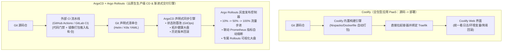

# 深度对比：Coolify 与 ArgoCD + Argo Rollouts Dashboard

> **文档版本**：v1.0.0  
> **制定日期**：2026-11-19  
> **议题定位**：现代前端与全栈部署控制台选型剖析：轻量一站式 PaaS vs 云原生工业级渐进式发布引擎  
> **核心结论**：两者在定位、分工与功能深度上存在**本质区别**：
> - 论**“生产级灰度发布、指标自动分析熔断、状态防漂移治理与高可用集群控制”**：**ArgoCD + Argo Rollouts 功能极强，具有压倒性优势（生产级金标准）**。
> - 论**“从源码拉取、自动识别构建打包到一键上线的全流程易用性（全包型 PaaS）”**：**Coolify 完胜（类似自建 Vercel）**。

---

## 一、 本质定位与设计哲学差异



- **Coolify 的定位是“全包 PaaS”**：
  把代码拉取、环境检测、源码编译、镜像构建、反向代理、数据库管理、域名证书申请全揽在自己身上。目的是让开发者**完全不需要懂 Docker、Kubernetes 和 Linux 运维**，点点鼠标就把代码跑起来。
- **ArgoCD + Argo Rollouts 的定位是“专业级交付与治理引擎”**：
  遵循 Unix 的“单职原则”，**不做代码构建（构建由 CI 负责）**，把所有功力全部聚焦在 **Kubernetes 生产级交付治理、精确流量切分、基于真实性能指标的自动化灰度分析与无人值守故障自愈**。

---

## 二、 核心功能逐项深度对比

| 功能维度 | Coolify (开源自建 Vercel) | ArgoCD + Argo Rollouts Dashboard | 哪个更强？（技术剖析） |
|---|---|---|---|
| **1. 源码构建能力 (CI)** | **自带构建器**，免配置。自动识别 Vite/Vue/React/Next.js 并打包成容器。 | **不做源码构建**。只接收构建好的镜像或 Helm Charts，由外部 CI（如 GitHub Actions）打包。 | **Coolify 强**（全包型，开箱即用）。 |
| **2. 灰度发布与金丝雀切流 (Canary)** | **弱**。本质是容器的全量替换或启动新容器。无法实现底层网关的百分比平滑流量分流。 | **极强（行业天花板）**。支持精细化的渐进式放量（如 `weight: 10%` $\rightarrow$ 观察 5 分钟 $\rightarrow$ `weight: 30%`），联动 Ingress 精确分流。 | **Argo Rollouts 完胜**。 |
| **3. 指标自动化分析与熔断回退** | **无**。仅支持基础的容器健康检查（挂了需人工介入排查并手动回滚）。 | **极强**。内置 **AnalysisTemplate**，灰度期间自动查询 Prometheus（如 5xx 错误率、P99 耗时）。若指标异常，**无需人工值守，毫秒级自动回退流量**。 | **Argo Rollouts 完胜**（真正的生产级自愈）。 |
| **4. 生产配置防漂移 (GitOps Drift)** | **无**。配置存储在 Coolify 自己的数据库中。线上被误操作改动无法自动检测和纠偏。 | **极强**。严格以 Git 仓作为唯一真实来源。每隔几秒比对集群状态，一旦有人在线上违规私改，立刻警报或强制自愈覆盖（Self-Heal）。 | **ArgoCD 完胜**（安全合规基线）。 |
| **5. 可视化大盘与交互体验** | 偏向“应用管理”体验（类似 Heroku/Vercel），界面现代化、友好，提供 PR 独立预览链接。 | 偏向“架构治理与流量大盘”体验，直观展示 Pod 树状拓扑、流量切分权重滑块、指标波动曲线。 | **各有千秋**：Coolify 偏前端开发直觉；Argo 偏架构与生产运维大盘。 |
| **6. 多环境与多集群扩展性** | 本质是主控制节点通过 SSH 远程操作 Docker 引擎，不适合大规模容器调度。 | 原生支持数十个跨机房、多可用区 Kubernetes 集群的统一部署与集中权限控制（RBAC + SSO）。 | **ArgoCD 完胜**。 |
| **7. 上手门槛与心智模型** | **极低**。无需任何 K8s 基础，适合小白与追求极速的敏捷团队。 | **中等**。需理解 Kubernetes 基本概念（Pod、Service、Ingress、CRD）。 | **Coolify 上手极快**。 |

---

## 三、 灰度控制能力差距的关键实战细节

为了更直观理解两者的功能差距，以**前端发版灰度控制**为例：

### 在 Coolify 中：
1. 开发者 Push 代码；
2. Coolify 触发打包；
3. 新镜像启动完成后，直接更新 Traefik 路由将域名指向新容器；
4. 如果新前端存在白屏 Bug，用户全量受影响，需管理员手动登录后台点击 Rollback。

### 在 ArgoCD + Argo Rollouts 中：
1. 开发者提交代码并完成镜像打包；
2. Argo Rollouts 启动金丝雀发布策略：
   ```yaml
   strategy:
     canary:
       steps:
         - setWeight: 10 # 1. 仅分流 10% 真实线上流量至新前端
         - pause: { duration: 5m } # 2. 暂停观察 5 分钟
         - analysis:
             templates:
               - templateName: frontend-error-rate-check # 3. 自动查询 Prometheus
         - setWeight: 50 # 4. 指标正常，放量到 50%
         - setWeight: 100 # 5. 全量切流
   ```
3. 在专属 Web 控制台上，可以看到新旧版本各自分配的实时流量百分比；
4. **核心威力**：在第 3 步，若 Prometheus 采集到前端 API 4xx/5xx 错误率突破 1%，Rollouts **在 0.5 秒内自动判定发布失败，自动切断新版流量并秒级回退回旧版本**，并在大盘上高亮报警。整个过程无需任何运维人员熬夜盯盘！

---

## 四、 针对本项目的选型结论与建议

根据我们已选定的 **“偏向生产环境推荐选型（方案 A：K3s + PolarisMesh + Prometheus）”**：

1. **功能强大度结论**：
   - 如果论**生产级治理、精细灰度控制、指标自动熔断、多副本高可用**：**ArgoCD + Argo Rollouts 功能强大得多，是工业界公认的生产级天花板**。
   - 如果论**前端全流程一站式开箱即用（带编译打包、自动识别框架）**：**Coolify 更简单易用**。
2. **落地建议**：
   - **强烈推荐方案：采用标准生产分工（CI 打包 + ArgoCD/Rollouts 可视化治理）**：
     - 由极轻量的前端多阶段 Dockerfile 负责编译（100% 杜绝构建环境污染）；
     - 由 **ArgoCD + Argo Rollouts Dashboard** 在 K3s 内部负责发布、拓扑监控、金丝雀分流大盘与一键回滚。
     - **收益**：前后端完全统一在同一个生产级控制台内，真正实现“生产同构、指标自愈与零停机灰度发布”！
