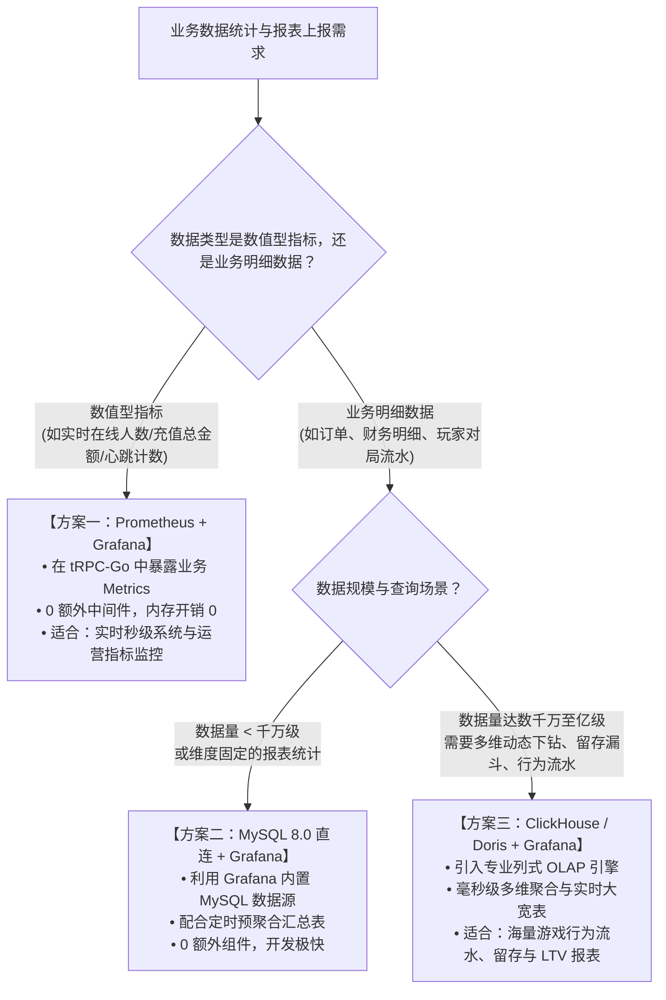

# 需不需要引入 Apache Doris 或 ClickHouse 配合 Grafana 做业务数据统计上报？

> **核心问题**：在当前微服务与可观测体系下，到底**需不需要**引入 Doris 或 ClickHouse 配合 Grafana 做业务数据统计上报？如果需要，两者谁更合适？

---

## 一、 核心结论先行：按业务形态与数据规模决策

对于业务数据统计上报，业界存在清晰的**三级演进路径**。并非所有项目一上来都需要引入沉重的大数据数仓组件：

---

## 二、 方案横向对比：Prometheus vs MySQL vs ClickHouse vs Doris

| 评估维度 | 方式一：Prometheus 自定义业务指标 | 方式二：MySQL 8.0 直连 Grafana | 方式三：ClickHouse + Grafana | 方式四：Apache Doris + Grafana |
|---|---|---|---|---|
| **本质定位** | 时序指标监控库 (TSDB) | 关系型事务主库 (OLTP) | 极致列式数仓 (OLAP) | 新一代实时分析型数据仓库 (OLAP) |
| **适合统计内容** | 实时 QPS、当前在线玩家数、接口错误率、充值瞬时速率 | 每日充值汇总、订单列表统计、用户活跃榜单、财务对账 | 亿级游戏对局埋点、用户行为点击流、留存率、LTV漏斗大宽表 | 复杂多表关联统计、千万级订单状态实时变更汇总、多维大盘 |
| **单机内存开销** | **0 MB** (现有监控套件已含) | **0 MB** (现有基础套件已含) | **~400 MB** (极低，C++单容器) | **~3 GB ~ 5 GB** (偏高，Java FE + C++ BE) |
| **Grafana 接入难度** | 开箱即用 (原生 Prometheus 源) | 开箱即用 (原生 MySQL 源，写 SQL 即可) | 安装 Grafana ClickHouse 官方插件 | 100% 兼容 MySQL 协议，直接用 MySQL 源连接 |
| **多表关联 (JOIN)** | 不支持 | 支持标准 SQL JOIN | 较弱，偏好单表“大宽表” | **极强** (分布式 CBO 优化器，强于 CH) |
| **数据更新能力** | 仅支持追加时序点 | 完美支持 ACID 事务与行级更新 | 弱 (主打大批量写入，更新很重) | **强** (支持实时高频 Upsert 与行级更新) |

---

## 三、 什么时候“不需要”引入 Doris 或 ClickHouse？

如果当前项目处于以下阶段，**强烈建议初期暂不引入**，避免过度设计增加本地内存与运维负担：

1. **每天产生的业务统计数据在几十万行到几百万行以内**：
   - 现有的 **MySQL 8.0** 加上合理索引完全可以在 50ms 内完成 `COUNT`、`SUM`、`GROUP BY` 查询；
   - **Grafana 官方自带 MySQL 数据源**：只需在 Grafana 配置页面填入 MySQL 地址（`127.0.0.1:3306`），直接写标准 SQL 即可配置出极度美观的柱状图、折线图与数据表格，**开发成本为 0**！
2. **统计需求以“大盘实时曲线”为主**：
   - 例如“当前全服在线人数”、“近 5 分钟充值笔数”、“道具消耗速率”；
   - 直接在 tRPC-Go 服务内埋入 Prometheus Counter/Gauge 暴露给已有的 Prometheus 抓取，Grafana 直接画图，不仅延迟低（秒级刷新），而且完全不查数据库，性能最高。

---

## 四、 什么时候“必须”引入？Doris 与 ClickHouse 谁更合适？

如果您的业务是**大型网游、海量埋点日志、用户留存/漏斗/LTV 等复杂多维分析**，数据量达到千万乃至数亿级，单靠 MySQL 会引发慢查询甚至拖垮主库，此时**必须引入专业 OLAP 引擎**。

在 **ClickHouse** 与 **Apache Doris** 之间，根据本地单机（16GB）与生产环境权衡：

### 1. 为什么在本地部署与常规微服务场景中，**ClickHouse** 更轻便？
- **单机资源开销极小**：
  - ClickHouse 为纯 C++ 编写的单一二进制架构，单容器运行内存仅需 **~400 MB**；
  - 而 Doris 架构分为 **FE (Frontend, Java 开发，吃内存大户)** 与 **BE (Backend, C++ 执行器)**，本地即使只跑 1 个 FE + 1 个 BE，常规配置下也至少需要 **3GB ~ 5GB 内存**，容易挤占本地宿主机的可用资源；
- **极限单表大宽表性能之王**：
  - 针对游戏日志、用户行为打点、运营流水，通常在写入端打成一张“宽表”，ClickHouse 的向量化计算与 SIMD 优化可以实现单机每秒扫描上亿行数据，秒出留存与漏斗图。

### 2. 什么场景下 **Apache Doris** 反超 ClickHouse？
- **大量跨表复杂 JOIN**：业务如果未做大宽表打平，需要频繁把“用户表”、“订单表”、“活动配置表”、“道具表”做多表动态复杂关联；
- **频繁数据更新（Upsert）**：比如订单状态随时可能发生变更，Doris 的 Unique Key 模型支持实时高频变更，而 ClickHouse 执行 Mutation 更新开销极大；
- **全兼容 MySQL 语法**：团队成员无需学习 ClickHouse 的特殊方言，且任何 MySQL BI 工具（Metabase/DataEase/Grafana）即插即用。

---

## 五、 落地推荐建议

### 1. 渐进式实施策略（推荐）
1. **第一优先级（零成本即刻可用）**：
   - 现有的 **MySQL 8.0 + Grafana** 负责日常订单、用户、财务报表；
   - 现有的 **Prometheus + Grafana** 负责实时在线、业务处理速率与打点监控；
2. **第二优先级（海量分析验证首选 ClickHouse）**：
   - 如果需要验证海量游戏行为流水、留存多维分析，在本地使用 `make analytics-up` 拉起 **ClickHouse (仅需 ~400MB 内存)** 即可完美闭环，无需部署笨重的 Doris；
   - 已在仓库中配套准备了 `deploy/docker-compose.analytics.yml`，随开随用，不占常驻内存。

### 2. 宿主机资源核算
- 基础微服务底座 + Polaris + MySQL + Redis + RabbitMQ + MinIO + MongoDB + 监控套件 + 双大盘：约 **5.4 GB**
- 若按需拉起 **ClickHouse**：仅增加 **~400 MB**，总内存约 **5.8 GB**，宿主机 16GB（可用 12GB）剩余 **6GB+**，完全游刃有余！
