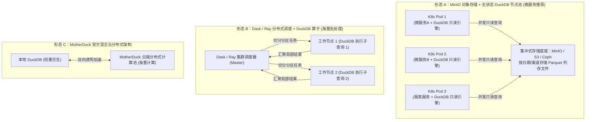

# DuckDB 分布式与多机支持深度解析：架构边界、演进形态与选型决策

> **核心提问**：DuckDB 不能分布式部署吗？到底支不支持多机运行？

---

## 一、 核心直接回答：原生不支持多机集群，但可通过存算分离与调度器实现多机能力

1. **开源原生 DuckDB**：**不支持多机分布式部署**（没有原生的 Master-Worker、分布式事务协调或 Raft 集群组件）；
2. **核心定位**：DuckDB 的核心哲学就是 **“单机纵向扩展（Scale-Up）做到极致”**，专为发挥现代单机多核 CPU、大内存与 NVMe 高速 SSD 的极限性能而设计，避免分布式系统的网络开销与运维复杂度；
3. **但业界已有 3 种成熟的“变相多机 / 分布式”工程形态**：
   - **形态 A：MinIO 存算分离 + 无状态 DuckDB 节点池（最推荐）**；
   - **形态 B：分布式调度器（Dask / Ray）+ DuckDB 执行算子**；
   - **形态 C：DuckDB 官方商业级混合云数仓（MotherDuck）**。

---

## 二、 现代架构如何让 DuckDB 具备“多机并发与扩展”能力？



### 1. 形态 A：存算分离（MinIO + 无状态节点池）—— 生产最推荐
- **核心逻辑**：存储与计算彻底解耦。
  - **存储层**：所有数据落入我们基础设施已配置好的 **MinIO 对象存储**，以分区 Parquet 格式持久化存放（如 `s3://logs/date=2026-11-20/part-*.parquet`）；
  - **计算层**：在 K3s 集群中可以水平扩展部署 5 个或 10 个业务 Pod，每个 Pod 启动一个无状态的 DuckDB 实例；
  - **优势**：各节点完全不需要相互通信、协调锁，全部并发向 MinIO 发起 HTTP Range 请求拉取各自所需的数据块进行计算，**轻松实现多机并行分析与高可用读**。

### 2. 形态 B：Dask-DuckDB / Ray-DuckDB（多机任务切分调度）
- 在大数据处理场景中，通过 Python 的分布式框架 **Dask** 或 **Ray** 作为大脑，把一个超大型查询（例如扫描 50 亿行日志）切分成 50 个分区任务，分发到 5 台 Worker 机器上，每台机器由 DuckDB 跑满多核算出局部结果，最后由 Master 汇总。

### 3. 形态 C：MotherDuck（官方商业化云原生方案）
- 由原 Google BigQuery 创立团队与 DuckDB 核心作者共同研发；
- 提供 Serverless 云端分布式 DuckDB 执行池，用户在本地敲一条 SQL，小数据在本地算，海量数据自动上云利用几十台机器分布式并行计算。

---

## 三、 认知反转：为什么 10 亿行以内，“单机”往往比“多机分布式”更快？

许多工程师认为“多机分布式肯定比单机强”，但在现代硬件条件下，这往往是一个巨大的误区：

```text
【单机 DuckDB 查询路径】
CPU Core ◄─── (总线直连 / 几纳秒) ───► 本地内存 / NVMe SSD
总开销：纯计算与纯内存读取，几乎 0 额外开销！

【分布式集群查询路径 (如未优化的分布式数仓)】
客户端 ──► 调度节点 Coordinator ──► 网络序列化 RPC ──► Worker 1 / 2 / 3 
                              ◄─── 网络传输 Shuffle ◄─── (千兆/万兆网卡瓶颈)
总开销：60% ~ 80% 的时间被网络延迟、数据打散重组 (Shuffle) 与节点协调吃掉！
```

- **现代单机硬件极其强大**：本地或云服务器单台机器动辄具备 16~64 个物理 CPU 核心、128GB 内存、读写速度超过 3000MB/s 的 NVMe SSD；
- **真实性能数据**：在 1 亿到 10 亿行数据集的基准测试中，**单机 DuckDB 凭借零网络开销、极速向量化，查询速度经常直接超越 3~5 个节点的传统分布式集群**！

---

## 四、 什么时候坚决不用 DuckDB，必须选择原生多机分布式数仓？

如果您面临以下场景，请**坚决放弃 DuckDB**，直接选用天然多机分布式的 **StarRocks** 或 **ClickHouse**：

1. **需要高可用（HA）多副本容灾与自动故障转移（Failover）**：
   - 生产环境要求任意一台服务器宕机时，数据库能够零感知自动秒级切换；
2. **海量实时数据高并发写入（> 10,000 QPS 写入）**：
   - DuckDB 采用单写锁，无法支撑数十个微服务并发实时向同一个库发起高频 `INSERT`；
3. **百亿级到千亿级全量数据实时复杂联查**：
   - 超出单台物理机最大扩展上限（即使加上磁盘溢出也耗时较长），必须利用数十台服务器的内存和磁盘联合并行处理；
4. **天然多机分布式的首选矩阵**：
   - **ClickHouse 分布式集群**：大宽表日志流水分片存储，亿级并发写入；
   - **StarRocks / Doris**：多机 MPP 架构，分布式 CBO 优化器，多表分布式 Shuffle Join 天花板。

---

## 五、 最终技术决议与落地指导

| 场景需求 | 推荐架构路线 | 理由 |
|---|---|---|
| **单机开发 / 10 亿行以内报表** | **MinIO + DuckDB (本地单机模式)** | 零常驻后台，零内存浪费，秒级出图，开发体验最爽 |
| **需要多机高并发只读扩展** | **MinIO 存算分离 + 多 Pod DuckDB** | 存储用 MinIO，计算在微服务 Pod 内部并发拉起 |
| **百亿级海量数据 / 生产高可用多机集群** | **直接选 StarRocks 或 ClickHouse** | 不要强行把 DuckDB 魔改成复杂集群，直接上成熟分布式数仓 |
