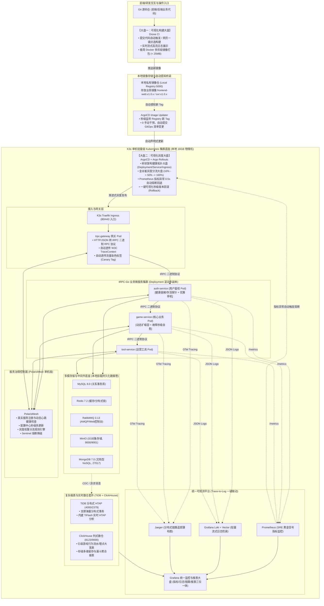
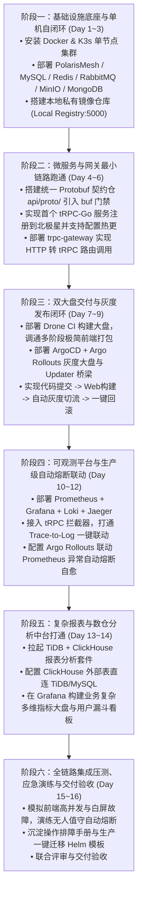

# 本地部署全套 tRPC-Go 微服务与生产级治理体系最终实施方案 (Final Master Plan)

> **方案版本**：v2.2.0 (全套微服务、存储扩容与复杂报表集成版)  
> **定稿日期**：2026-11-19  
> **核心原则**：生产同构 (Production Parity)、单机自闭环 (Self-Contained)、契约驱动 (Schema as Code)、全可视化操作 (Dual-Dashboard GitOps)、事务与分析解耦 (HTAP + OLAP)  
> **确定技术栈**：**K3s + PolarisMesh + trpc-gateway + Prometheus/Grafana/Loki/Jaeger + 双大盘 (Drone CI + ArgoCD/Rollouts) + RabbitMQ + MinIO + MongoDB + TiDB + ClickHouse**

---

## 一、 系统全景架构与数据流拓扑

系统整体由 **“统一接入网关 + tRPC-Go 微服务网格 + 北极星治理控制面 + 一体化可观测底座 + 双大盘交付体系 + 多模存储层 + 复杂报表/数仓计算引擎”** 构成：

---

## 二、 最终确定的技术选型矩阵与规划

| 架构模块 | 最终确定选型 | 容器化/运行方式 | 端口规划 | 关键功能与生产同构特性 |
|---|---|---|---|---|
| **集群编排底座** | **K3s** | 单节点集群系统服务 | 6443 (API Server) | 完整的标准 Kubernetes 规范、Pod 探针、Service CoreDNS 与滚动发布 |
| **微服务框架** | **tRPC-Go** | Go 1.24 原生/容器 | 10001 ~ 10010 | 腾讯开源高性能 RPC 框架，Protobuf 契约驱动，支持多协议与拦截器插件 |
| **服务治理中心** | **PolarisMesh (北极星)** | Docker / K3s Pod | 8090 (UI), 8091 (gRPC) | 服务注册发现心跳、配置中心秒级热更新、动态灰度染色路由与熔断降级 |
| **微服务 API 网关** | **trpc-gateway** | K3s Deployment | 8080 (HTTP), 8443 (HTTPS) | 原生 Protobuf 契约解包，HTTP/JSON 转 tRPC 二进制，透传 Trace 与染色标签 |
| **消息队列中间件** | **RabbitMQ (带管理后台)** | 容器 (挂载持久卷) | 5672 (AMQP), 15672 (Web UI) | 业务异步解耦、任务派发、开箱即用 Web 管理控制台、灵活 Topic 路由与死信队列 |
| **分布式对象存储** | **MinIO (私有 S3)** | Docker 容器 | 9000 (S3 API), 9001 (Web 控制台) | 解决容器无状态下微服务头像/附件/媒体上传共享，100% 兼容 S3 协议 |
| **文档型 NoSQL** | **MongoDB 7.0** | Docker 容器 | 27017 (Mongo 协议) | 游戏角色档案、道具背包、多层嵌套装备与动态 JSON 草稿表单存储 |
| **分布式 HTAP 数据库** | **TiDB v8.1 (PD+TiKV+TiDB)** | Docker Compose 编排 | 4000 (MySQL), 2379 (PD), 10080 | 兼容 MySQL 协议，支撑海量分布式事务，自带 TiFlash 提供零 ETL 的实时报表分析 |
| **极致 OLAP 列式数仓** | **ClickHouse 24** | Docker 容器 | 8123 (HTTP/Web), 9000 (Native) | 专为万亿级海量大宽表设计，秒级多维留存、LTV 漏斗与游戏埋点报表聚合 |
| **【大盘一】构建大盘** | **Drone CI / Woodpecker** | Docker 单容器 | 8000 (Web UI) | **可视化源码构建**：接入 Git，点击按钮一键打包，流式查看多阶段镜像构建日志 |
| **自动化联动桥梁** | **argocd-image-updater** | K3s Controller | 内网运行 | **0 手动干预**：秒级自动监听镜像仓新 Tag，自动向 Git 提交更新触发灰度 |
| **【大盘二】灰度大盘** | **ArgoCD + Argo Rollouts** | K3s Pods | 8081 (ArgoCD), 31000 (Rollouts UI) | **可视化灰度与自愈**：树状拓扑大盘、10% 金丝雀分流、Prometheus 指标自动熔断、一键秒级回滚 |
| **分布式链路追踪** | **OpenTelemetry + Jaeger** | K3s Pod | 16686 (UI), 4317 (OTLP gRPC) | W3C TraceContext 全链路透传，全链路 Span 瀑布图与慢调用毫秒级定位 |
| **质量指标监控** | **Prometheus + Alertmanager** | K3s Pod | 9090 (Prometheus), 9093 | SRE 黄金信号指标采集（成功率 > 99.5%、P99 延时、QPS、Goroutine 数量） |
| **结构化日志系统** | **Vector + Grafana Loki** | K3s DaemonSet/Pod | 3100 (Loki API) | 结构化 JSON 流式日志存储，比传统 ELK 节约 80% 开销，支持 Trace-to-Log 一键跳转 |
| **统一大盘与报表可视化**| **Grafana 11.x** | K3s Pod | 3000 (Web 控制台) | 聚合质量大盘、业务运营大盘、Loki 日志、Jaeger 追踪与 ClickHouse 报表插件 |
| **基础关系型与缓存** | **MySQL 8.0 + Redis 7.2** | 容器 (本地挂载持久化卷) | 3306 (MySQL), 6379 (Redis) | 真实关系数据库与分布式缓存环境，验证真实连接池、事务与分布式锁 |

---

## 三、 双大盘与复杂报表交付运作机制

### 1. 业务持续交付闭环（Drone CI + ArgoCD + Rollouts）
1. 开发者推送代码 $\rightarrow$ **Drone CI 大盘**自动触发多阶段构建，打包极简镜像推入私有仓库；
2. **argocd-image-updater** 感知镜像更新，自动提交 GitOps 清单变更；
3. **Argo Rollouts 大盘**启动 10% 金丝雀放量，Prometheus 指标正常则平滑全量，异常则 0.5s 内秒级自动熔断回退。

### 2. 复杂报表与实时数仓闭环（TiDB + ClickHouse）
1. **在线事务层 (OLTP)**：日常订单、用户交易读写 TiDB/MySQL，保障强一致事务；
2. **轻量即时报表 (HTAP)**：TiDB 内部通过 TiFlash 列存副本，秒级完成订单多维跨月汇总，无需繁重 ETL；
3. **海量行为与多维分析 (OLAP)**：用户游戏对局、操作埋点事件实时微批推入 ClickHouse，ClickHouse 原生向量化计算单机每秒扫描上亿行；
4. **统一展现层**：Grafana 安装 ClickHouse / MySQL 数据源插件，直接构建实时运营与财务大盘。

---

## 四、 本地宿主机硬件资源开销预算 (测算充分安全)

宿主机物理规格为 **Ubuntu 24.04、16GB 物理内存 (当前可用 12GB)、300GB 磁盘、15GB Swap**：

| 组件分类 | 具体组件 | 预估内存占用 | 预估 CPU 占用 | 运行建议与状态 |
|---|---|---|---|---|
| **底座与治理控制面** | K3s + PolarisMesh | ~1.1 GB | 0.4 ~ 0.8 核 | 极其轻量稳定 |
| **网关与业务服务** | trpc-gateway + 业务服务多副本 | ~0.7 GB | 0.4 ~ 1.0 核 | 满足微服务全链路调用 |
| **双大盘交付套件** | Drone CI + ArgoCD + Rollouts + Updater | ~0.7 GB | 0.3 ~ 0.8 核 | 全可视化构建与灰度控制 |
| **可观测平台** | Prometheus + Loki + Jaeger + Grafana + Vector | ~1.3 GB | 0.4 ~ 0.9 核 | 高性能低内存组合 |
| **基础存储与消息中间件**| MySQL 8.0 + Redis 7.2 + RabbitMQ 3.13 | ~1.15 GB | 0.3 ~ 0.6 核 | 含 RabbitMQ Web 管理台 |
| **对象存储与 NoSQL** | MinIO (~150MB) + MongoDB 7.0 (~300MB) | ~0.45 GB | 0.2 ~ 0.4 核 | 解决附件/头像与文档数据 |
| **复杂报表与数仓套件** | ClickHouse (~400MB) + TiDB (~1.4GB) | ~1.8 GB | 0.5 ~ 1.5 核 | `make analytics-up` 按需拉起 |
| **全套生态终极大汇总** | **全套微服务 + 治理 + 双大盘 + 存储 + 报表数仓** | **约 7.2 GB** | **约 2.5 ~ 6.0 核** | **宿主机可用 12GB，仍剩余 4.8GB+，且具备 15GB Swap 保护，毫无压力** |

---

## 五、 六阶段落地实施路线图 (即将开始执行)

---

## 六、 下一步即刻执行准备 (Immediate Action Item)

全套技术选型与多模存储/报表架构均已就绪，**即将正式启动阶段一（基础设施底座与单机自闭环）**：
1. 本地安装并配置 Docker Engine 与 K3s 单节点服务；
2. 启动基础治理套件 (`make infra-up`)，一键拉起 PolarisMesh、MySQL、Redis、RabbitMQ、MinIO 与 MongoDB；
3. 按需启动复杂报表套件 (`make analytics-up`)，拉起 TiDB 与 ClickHouse；
4. 验证本地各控制台访问连通性：北极星 (8090)、RabbitMQ (15672)、MinIO (9001)、ClickHouse Web (8123)。
