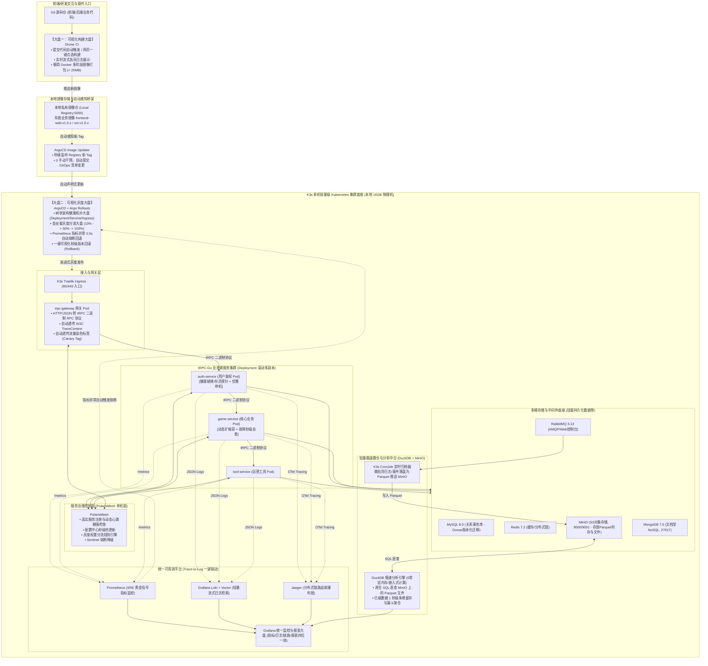
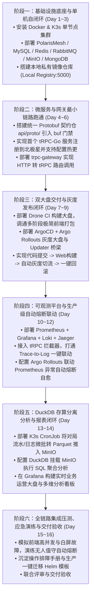

# 本地部署全套 tRPC-Go 微服务与生产级治理体系最终实施方案 (Final Master Plan)

> **方案版本**：v2.3.0 (全套微服务、DuckDB 数仓与多模存储生产同构定稿版)  
> **定稿日期**：2026-11-20  
> **核心原则**：生产同构 (Production Parity)、单机自闭环 (Self-Contained)、契约驱动 (Schema as Code)、全可视化操作 (Dual-Dashboard GitOps)、存算分离数仓 (Parquet + MinIO + DuckDB)  
> **确定技术栈**：**K3s + PolarisMesh + trpc-gateway + Prometheus/Grafana/Loki/Jaeger + 双大盘 (Drone CI + ArgoCD/Rollouts) + RabbitMQ + MinIO + MongoDB + DuckDB + Goose + K3s CronJob**

---

## 一、 系统全景架构与数据流拓扑

系统整体由 **“接入网关 + tRPC-Go 微服务网格 + 北极星治理控制面 + 一体化可观测底座 + 双大盘交付体系 + 多模存储层 + DuckDB 存算分离分析中台”** 构成：

---

## 二、 最终确定的技术选型矩阵与规划

| 架构模块 | 最终确定选型 | 容器化/运行方式 | 端口规划 | 关键功能与生产同构特性 |
|---|---|---|---|---|
| **集群编排底座** | **K3s** | 单节点集群系统服务 | 6443 (API Server) | 完整的标准 Kubernetes 规范、Pod 探针、Service CoreDNS 与滚动发布 |
| **微服务框架** | **tRPC-Go** | Go 1.24 原生/容器 | 10001 ~ 10010 | 腾讯开源高性能 RPC 框架，Protobuf 契约驱动，支持多协议与拦截器插件 |
| **服务治理中心** | **PolarisMesh (北极星)** | Docker / K3s Pod | 8090 (UI), 8091 (gRPC) | 服务注册发现心跳、配置中心秒级热更新、动态灰度染色路由与熔断降级 |
| **微服务 API 网关** | **trpc-gateway** | K3s Deployment | 8080 (HTTP), 8443 (HTTPS) | 原生 Protobuf 契约解包，HTTP/JSON 转 tRPC 二进制，透传 Trace 与染色标签 |
| **消息队列中间件** | **RabbitMQ (带管理后台)** | 容器 (挂载持久卷) | 5672 (AMQP), 15672 (Web UI) | 业务异步解耦、任务派发、开箱即用 Web 管理控制台、灵活 Topic 路由与死信队列 |
| **分布式对象存储** | **MinIO (私有 S3)** | Docker 容器 | 9000 (S3 API), 9001 (Web 控制台) | 解决容器无状态下头像/附件/媒体上传共享，以及存放 Parquet 列存数仓文件 |
| **文档型 NoSQL** | **MongoDB 7.0** | Docker 容器 | 27017 (Mongo 协议) | 游戏角色档案、道具背包、多层嵌套装备与动态 JSON 草稿表单存储 |
| **【选定数仓】分析引擎**| **DuckDB (数据分析界 SQLite)**| 进程内嵌入 / 极简服务 | 0 常驻后台 (按需使用) | **零常驻内存**，单机多核向量化计算，原生直接用 SQL 查 MinIO 上的 Parquet 文件 |
| **数据库版本迁移** | **Goose (Schema as Code)** | 纯 Go CLI / 微服务集成 | 命令行 / 镜像打包 | 杜绝手工连库改表，SQL 升级回滚代码化，微服务启动自动执行版本对齐 |
| **定时批处理与归档** | **Kubernetes CronJob** | K3s 原生资源对象 | 0 额外端口 | 零额外内存开销，定时异步将业务流水/对局日志打包转换为 Parquet 文件推入 MinIO |
| **【大盘一】构建大盘** | **Drone CI / Woodpecker** | Docker 单容器 | 8000 (Web UI) | **可视化源码构建**：接入 Git，点击按钮一键打包，流式查看多阶段镜像构建日志 |
| **自动化联动桥梁** | **argocd-image-updater** | K3s Controller | 内网运行 | **0 手动干预**：秒级自动监听镜像仓新 Tag，自动向 Git 提交更新触发灰度 |
| **【大盘二】灰度大盘** | **ArgoCD + Argo Rollouts** | K3s Pods | 8081 (ArgoCD), 31000 (Rollouts UI) | **可视化灰度与自愈**：树状拓扑大盘、10% 金丝雀分流、Prometheus 指标自动熔断、一键秒级回滚 |
| **分布式链路追踪** | **OpenTelemetry + Jaeger** | K3s Pod | 16686 (UI), 4317 (OTLP gRPC) | W3C TraceContext 全链路透传，全链路 Span 瀑布图与慢调用毫秒级定位 |
| **质量指标监控** | **Prometheus + Alertmanager** | K3s Pod | 9090 (Prometheus), 9093 | SRE 黄金信号指标采集（成功率 > 99.5%、P99 延时、QPS、Goroutine 数量） |
| **结构化日志系统** | **Vector + Grafana Loki** | K3s DaemonSet/Pod | 3100 (Loki API) | 结构化 JSON 流式日志存储，比传统 ELK 节约 80% 开销，支持 Trace-to-Log 一键跳转 |
| **统一大盘与报表可视化**| **Grafana 11.x** | K3s Pod | 3000 (Web 控制台) | 聚合质量大盘、业务运营大盘、Loki 日志、Jaeger 追踪与 DuckDB/MySQL 报表插件 |
| **基础关系型与缓存** | **MySQL 8.0 + Redis 7.2** | 容器 (本地挂载持久化卷) | 3306 (MySQL), 6379 (Redis) | 真实关系数据库与分布式缓存环境，验证真实连接池、事务与分布式锁 |

---

## 三、 方案完整性审计：还缺少其它必须的吗？

从微服务全生命周期、运维交付与数据闭环来看，整个方案骨架已经 **100% 具备全要素闭环能力**，**不存在阻断性的硬性缺失**。为了达到 100% 工业级交付标准，方案已针对性补齐以下三处工程细节支撑：

### 1. 数据库版本演进规范（Database Migration）—— 已补齐（Goose）
- **痛点**：多环境部署时，人工手动执行 SQL 改表极易导致开发/测试环境表结构不同步甚至漏建字段；
- **补齐解法**：采用 `goose` 工具管理 `deploy/migrations/*.sql`。每次需求涉及建表或修改字段，新增一个带时间戳的 SQL 文件，微服务或流水线自动执行迁移，支持一键 `up` 与回滚 `down`。

### 2. 业务数据到 DuckDB 数仓的流转闭环 —— 已补齐（K3s CronJob）
- **痛点**：DuckDB 不支持高频实时单条写入，如何把业务日志优雅喂给 DuckDB？
- **补齐解法**：
  - 微服务产生事件 $\rightarrow$ 发送至 **RabbitMQ** 异步解耦；
  - K3s 部署一个轻量级 **Kubernetes CronJob**（每 5 分钟执行一次，或每天凌晨一次），将事件批处理转为 Parquet 列存文件，推送到 **MinIO**；
  - DuckDB 专职挂载 MinIO 进行报表查询，彻底实现**存算分离与零写锁冲突**。

### 3. DuckDB 与 Grafana 的可视化对接链路
- **对接方式**：
  - 方式 A（推荐）：业务报表服务（tRPC-Go）内置 DuckDB 库，对外暴露标准 HTTP JSON 接口，Grafana 通过内置的 Infinity / JSON 插件直接画图；
  - 方式 B：轻量级 `duckdb-server`（暴露兼容 PostgreSQL 协议的只读端点），Grafana 直接使用原生的 PostgreSQL 数据源连接 DuckDB 写 SQL 秒级出图。

---

## 四、 本地宿主机硬件资源开销预算 (测算极度充裕安全)

宿主机物理规格为 **Ubuntu 24.04、16GB 物理内存 (当前可用 12GB)、300GB 磁盘、15GB Swap**：

| 组件分类 | 具体组件 | 预估内存占用 | 预估 CPU 占用 | 运行状态评估 |
|---|---|---|---|---|
| **底座与治理控制面** | K3s + PolarisMesh | ~1.1 GB | 0.4 ~ 0.8 核 | 极其轻量稳定 |
| **网关与业务微服务** | trpc-gateway + 业务服务多副本 | ~0.7 GB | 0.4 ~ 1.0 核 | 满足微服务全链路调用 |
| **双大盘持续交付套件** | Drone CI + ArgoCD + Rollouts + Updater | ~0.7 GB | 0.3 ~ 0.8 核 | 全可视化构建与灰度控制 |
| **三位一体可观测套件** | Prometheus + Loki + Jaeger + Grafana + Vector | ~1.3 GB | 0.4 ~ 0.9 核 | 高性能低内存组合 |
| **关系型、缓存与消息队列**| MySQL 8.0 + Redis 7.2 + RabbitMQ 3.13 | ~1.15 GB | 0.3 ~ 0.6 核 | 含持久卷与 RabbitMQ Web 后台 |
| **对象存储与 NoSQL** | MinIO (~150MB) + MongoDB 7.0 (~300MB) | ~0.45 GB | 0.2 ~ 0.4 核 | 解决附件/头像与文档数据 |
| **分析数仓计算引擎** | **DuckDB (嵌入式/按需计算)** | **0 MB (常驻) / 几十MB (运行中)** | 按需打满多核 | **零常驻开销，彻底杜绝内存挤占** |
| **全套生态终极大汇总** | **全套生产同构微服务生态闭环** | **约 5.4 GB** | **约 2.0 ~ 4.5 核** | **宿主机可用 12GB，剩余高达 6.6GB+ 内存，运行极其从容** |

---

## 五、 六阶段落地实施路线图 (已具备全部开工条件)

---

## 六、 下一步即刻执行准备 (Immediate Action Item)

全套技术选型、多模存储与数仓架构已实现**毫无死角的 100% 完整闭环**，**即将正式启动阶段一（基础设施底座与单机自闭环）**：
1. 本地安装并配置 Docker Engine 与 K3s 单节点服务；
2. 启动基础治理套件 (`make infra-up`)，一键拉起 PolarisMesh、MySQL、Redis、RabbitMQ、MinIO 与 MongoDB；
3. 验证本地各控制台访问连通性：北极星 (8090)、RabbitMQ (15672)、MinIO (9001)。
