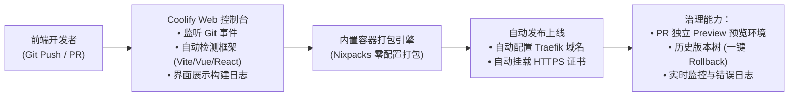

# 市面主流前端可视化平台评测：构建、发布与工程治理 (Frontend WebUI Platforms & Governance)

> **文档版本**：v1.0.0  
> **制定日期**：2026-11-19  
> **核心定位**：针对“告别纯脚本化（Makefile/Shell/CLI），寻求带 Web UI 的现代化前端构建、发布、灰度与环境治理平台”的诉求，提供市面成熟开源与企业级现成产品深度评测与选型指南。

---

## 一、 市面主流前端 Web UI 构建发布平台全景对比

| 平台名称 | 核心定位与特色 | 前端构建与适配能力 | 部署发布与回滚 (Web UI) | 工程治理能力 (环境/灰度/监控) | 本地单机部署可行性 | 推荐指数 |
|---|---|---|---|---|---|---|
| **Coolify**<br>*(自建版 Vercel)* | **当前全球最火的开源自托管 PaaS** (GitHub 35k+ Stars) | • 自动检测 Vue/React/Vite/Next.js 等主流前端。<br>• 零配置自动容器打包 (基于 Nixpacks)。 | • Git Push 自动触发打包。<br>• 历史构建版本树一目了然。<br>• **界面一键秒级回滚**。 | • **PR 自动生成独立 Preview 预览环境**。<br>• 自动 SSL 证书与域名管理。<br>• 容器 CPU/内存/健康日志监控。 | ✅ **极佳**：单 Docker 容器脚本一键安装，内存仅需 ~300MB。 | ⭐⭐⭐⭐⭐<br>(前端专属最爽体验) |
| **Dokploy**<br>*(新一代轻量 PaaS)* | 现代化极简 Docker/K3s 全栈部署控制台 (基于 Node/Vue) | • 支持标准 Dockerfile、静态站点及各类 JS 全栈框架。 | • Web 界面可视化编排。<br>• 自动化部署与版本历史回滚。 | • 自动集成 Traefik 路由与域名绑定。<br>• 基础资源与日志监控。 | ✅ **极佳**：极轻量，单机资源消耗 < 200MB。 | ⭐⭐⭐⭐<br>(轻量极简备选) |
| **Zadig**<br>*(云原生环境治理平台)* | **国内开源的企业级微服务与前端环境治理平台** | • 界面化配置 Node 版本、打包缓存、输出目录。 | • 声明式构建流水线。<br>• 前端直连 K8s Ingress 自动发布与回滚。 | • **强大的多套自测/联调环境治理**（前端可自由关联指定后端环境）。<br>• 界面化灰度发布与审批流。 | ⚠️ **较重**：功能极其强大，但完整单机运行需 2~3GB 内存。 | ⭐⭐⭐⭐<br>(复杂团队多环境首选) |
| **ArgoCD + Rollouts**<br>*(云原生 GitOps 金标准)* | **Kubernetes 官方事实标准的可视化交付控制台** | • 由 CI (如 GitHub Actions) 负责打包镜像。<br>• ArgoCD 负责可视化发布与拓扑展示。 | • 网页直观树状展示 Pod/Service/Ingress 状态。<br>• **History & Rollback 界面一键回滚**。 | • **Argo Rollouts 专用仪表盘**：可视化查看灰度流量比例（10% -> 50% -> 100%）、异常自动熔断。 | ✅ **优秀**：原生部署在 K3s 集群内，内存消耗约 ~300MB。 | ⭐⭐⭐⭐⭐<br>(与 K3s 契合度最高) |

---

## 二、 核心方案深度剖析与功能展示

### 1. 方案一：Coolify —— 前端开发者体验最佳的“自建版 Vercel”

Coolify 是当前开源界最推崇的自建应用交付平台。对于习惯了 Vercel / Netlify 的前端团队来说，体验几乎零学习成本。



#### 核心治理特性：
1. **零脚本配置**：在 Web 界面绑定 GitHub/GitLab 仓库后，平台自动识别是 Vite 还是 Webpack，自动执行 `pnpm install && pnpm build`，完全不需要手写构建脚本。
2. **Pull Request 独立预览环境 (Preview Deployments)**：
   - 团队成员提了一个 PR，Coolify 会自动为该 PR 临时拉起一个独立的前端实例（例如生成 `pr-12.gametool.local`），测试人员/产品经理可直接在网页上验收，PR 合并后临时环境自动销毁。
3. **版本管理与一键秒级回滚**：
   - Web 界面提供清晰的 **Deployments 历史时间轴**；
   - 点击任意历史版本旁边的 **“Rollback to this version”**，新版本瞬间切换生效。
4. **本地一键安装运行**：
   ```bash
   curl -fsSL https://cdn.coollabs.io/coolify/install.sh | bash
   ```
   安装后浏览器直接打开 `http://localhost:8000` 即可进入美观的可视化操作控制台。

---

### 2. 方案二：ArgoCD + Argo Rollouts Dashboard —— 与我们 K3s 最契合的云原生生产控制台

由于我们后端和底层已确定采用 **K3s 集群底座**，引入 **ArgoCD** 能将前端和后端微服务统一纳入**同一个生产级 Web UI 平台**中管理。

#### 核心治理特性：
1. **可视化拓扑大盘**：
   - 登录 ArgoCD 网页，可以直观看到 `frontend-web` 的 Deployment 拓扑树、实时 Pod 健康状态（绿色为正常，黄色为启动中，红色为崩溃）。
2. **全界面化版本追溯与一键回滚**：
   - 点击前端应用 $\rightarrow$ **“History and Rollback”**：
   - 界面按时间列出所有发布的版本号、Git Commit 信息、发布人；
   - 鼠标点击选中上一稳定版本，点击 **“Rollback”**，K3s 会在 2 秒内完成滚动切回。
3. **Argo Rollouts 灰度发布控制大盘 (Canary Dashboard)**：
   - 官方自带专属 Web UI；
   - 可以可视化看到：当前 Stable 版本占 90% 流量，Canary 灰度版本占 10% 流量；
   - 界面提供 **“Promote”**（确认全量推进）与 **“Abort”**（放弃灰度立即切回）按钮，点选即可实现精细化灰度治理。

---

### 3. 方案三：Zadig —— 针对复杂微服务环境协同的前端环境治理专家

如果团队前端开发经常需要跟不同后端的开发分支进行联调：
1. **多套集成环境治理**：
   - 在 Zadig 界面上，前端可以一键点击“复制联调环境”；
   - 前端无需求助运维，在界面上自由切换指向“开发分支的 auth-service”还是“主干的 auth-service”。
2. **前后端版本协同发布矩阵**：
   - 在发布面板上，可以勾选前端 `v1.2.0` 与后端 `v1.2.0` 进行联合审批发布。

---

## 三、 技术决策建议：选 Coolify 还是 ArgoCD？

针对当前项目的具体情况，给出以下决策建议：

| 评估维度 | 建议选 **Coolify** 的场景 | 建议选 **ArgoCD (含 Rollouts)** 的场景 |
|---|---|---|
| **首要诉求** | 追求纯粹、轻便、直观的**前端发布体验**，希望像使用 Vercel 一样在网页上点选完成构建和回滚。 | 追求与当前底座 **K3s 架构 100% 原生融合**，希望前后端所有应用都在同一个生产级控制台里管理。 |
| **构建方式** | 平台自带构建器，在 Web 上直接看打包进度与日志。 | 由 CI (GitHub Actions/本地脚本) 负责编译镜像，ArgoCD 专职负责发布与灰度控制。 |
| **灰度控制** | 支持多环境管理与 PR 预览环境。 | 支持极其严谨的生产级金丝雀分流、指标自动分析与渐进式发布。 |
| **本地资源开销**| 约 300 ~ 400 MB 内存。 | 约 250 ~ 350 MB 内存。 |

### 落地推荐：
1. **最轻便、交互最现代、完全摆脱脚本**：直接本地拉起 **Coolify**，前端所有构建打包、域名解析、多环境预览和一键回滚全在 Coolify Web 控制台完成。
2. **架构最统一、前后端一体化**：在 K3s 内直接部署 **ArgoCD**，前端构建镜像后由 ArgoCD 网页可视化大盘负责发布、监控与秒级回滚。
