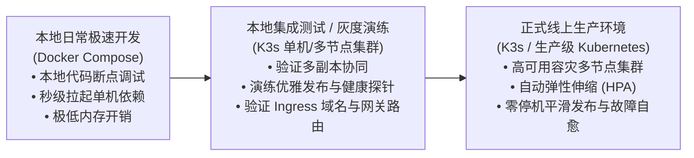

# 04. 生产环境选型分析：K3s vs Docker Compose 深度对比

> **记录时间**：2026-11-19  
> **议题定位**：微服务生产环境与集成环境编排底座选型分析与架构决策  
> **核心结论**：**生产环境中强烈推荐 K3s（或标准 Kubernetes K8s），而非 Docker Compose。**

---

## 一、 核心定位与本质区别

| 维度 | Docker Compose | K3s (Lightweight Kubernetes) |
|---|---|---|
| **本质定位** | **单机多容器定义与管理工具** | **CNCF 官方认证的轻量级生产级容器集群编排系统** |
| **设计目标** | 方便开发者在单机上一键拉起多个相关联的 Docker 容器 | 为边缘计算、单机/多节点中小规模生产集群提供标准的 Kubernetes 能力 |
| **控制面与调度** | 无 Master 架构，直接向本地 Docker Daemon 发送启动/停止 API | 具备完整的 Kubernetes 控制面（API Server, Controller Manager, Scheduler, CoreDNS） |
| **集群多节点能力** | **不支持** 原生多物理机/虚拟机跨主机调度与协同（单机宕机则全挂） | **原生支持** Master-Worker 多节点分布式拓扑，容器可自动跨机分布与漂移 |

---

## 二、 生产级环境关键能力全方位对比

### 1. 高可用与故障自愈 (High Availability & Self-Healing)
- **Docker Compose**：
  - 仅支持基础的退出重启策略（`restart: always` 或 `unless-stopped`）。
  - **严重短板**：若机器发生内核假死、宿主机硬件断电、或者进程发生死锁（进程未退出但已无法对外提供服务），Docker Compose 完全无法感知，更无法将容器调度转移到其他机器。
- **K3s**：
  - 提供标准的 **Pod 生命周期管理** 与三大探针（Liveness 存活探针、Readiness 就绪探针、Startup 启动探针）。
  - 当节点故障宕机时，Control Plane 会在超时阈值内触发自动驱逐（Eviction），并在其他正常 Worker 节点上自动重建拉起 Pod，保障微服务 SLA 不中断。

### 2. 平滑升级与零停机滚动更新 (Rolling Update & Zero-Downtime)
- **Docker Compose**：
  - 升级镜像时通常是“先停旧容器，再起新容器”。
  - 即使利用 `scale` 扩容，由于缺乏与上游网关/负载均衡器的健康感知协同，极易在容器刚启动未完成初始化时被塞入流量，导致线上出现 502/连接重置等故障。
- **K3s**：
  - 原生支持 Deployment 的声明式滚动更新策略（`maxSurge`, `maxUnavailable`）。
  - 配合服务优雅关停（PreStop Hook）与 Readiness 探针：**只有当新版本 Pod 完全就绪并通过健康检查后，Ingress/Service 才会将流量切入；旧版本 Pod 收到 SIGTERM 后等待现有长连接处理完毕才平滑下线**，实现真正的业务无感知零停机发布。

### 3. 弹性扩缩容 (Auto-Scaling)
- **Docker Compose**：
  - 不支持基于性能指标的自动伸缩，只能靠人工手动执行命令扩容，且扩容的实例仍然挤在同一台物理机上，受限于单机资源瓶颈。
- **K3s**：
  - 原生集成 HPA (Horizontal Pod Autoscaler)，可基于 CPU、内存或 Prometheus 自定义业务指标（如 QPS、并发连接数），在流量峰值到来时秒级自动扩容副本，并在低峰期自动缩容节约资源。

### 4. 统一网络拓扑与跨节点通信 (CNI & Service Discovery)
- **Docker Compose**：
  - 局限于 Docker 本地的 Bridge 网络。若业务规模扩大需要增加第二台服务器，单机 Bridge 网络无法跨机直接通信，需要引入繁琐的 Host 端口映射或外部组网工具。
- **K3s**：
  - 内置轻量级生产 CNI（默认 Flannel），构建全集群扁平的 Pod Overlay 虚拟网络。
  - 集群内置 CoreDNS 与 Service 负载均衡（ClusterIP），集群内部微服务之间可以通过 `http://service-name.namespace:port` 跨节点透明通信，完全无需关注目标 Pod 落在哪个物理节点上。

### 5. 声明式配置、机密管理与 GitOps (Config & Security)
- **Docker Compose**：
  - 依赖 `.env` 或环境变量文件，数据库密码和 API 密钥经常明文留在宿主机文件系统或代码仓，权限控制粗糙。
- **K3s**：
  - 原生提供 ConfigMap 与 Secret 对象，天然支持 RBAC（基于角色的访问控制）。
  - 完全兼容云原生事实标准的声明式交付与 GitOps 工具链（如 ArgoCD、Flux），所有集群状态与配置由 Git 仓库驱动，变更可审计、可追溯、可一键回滚。

### 6. 云原生与未来架构演进无缝衔接 (Extensibility & Future-Proof)
- **Docker Compose**：
  - 为 Compose 编写的 `docker-compose.yml` 是 Docker 私有规范，无法直接部署到云厂商的公有云（如阿里云 ACK、腾讯云 TKE、AWS EKS）容器服务上。
- **K3s**：
  - 100% 兼容 Kubernetes API。在 K3s 上编写的 YAML 文件、Helm Charts、CRD（自定义资源）可以 **零成本、无缝迁移到任何生产级大型 Kubernetes 集群** 中，避免二次架构重构。

---

## 三、 对比总结矩阵

| 对比维度 | Docker Compose | K3s (轻量生产级 Kubernetes) |
|---|---|---|
| **推荐适用场景** | 本地极速开发、单机轻量测试、单体小工具 | **正式生产环境**、预发/集成环境、边缘计算节点 |
| **多节点跨机调度** | ❌ 不支持 | ✅ 原生支持 |
| **故障自动驱逐与迁移**| ❌ 不支持（单机挂即全挂） | ✅ 原生支持（秒级漂移自愈） |
| **零停机滚动发布** | ❌ 很难做到无缝 | ✅ 原生支持（配合优雅关停与探针） |
| **自动弹性伸缩 (HPA)** | ❌ 仅支持手动调整 | ✅ 原生支持（CPU/内存/自定义指标） |
| **内置 Ingress/网关** | ❌ 需自建并写死反向代理 | ✅ 内置 Traefik / 可扩展 Nginx/APISIX |
| **GitOps/Helm 支持** | ❌ 缺乏生态支持 | ✅ 完全兼容 Helm / ArgoCD / 云原生生态 |
| **内存与运维成本** | 极低（几乎 0 额外内存） | 很低（单机约 500MB~1GB 内存开销，开箱即用单二进制） |

---

## 四、 最佳工程实践建议：双模演进路线

建议团队在本项目及后续微服务演进中采取 **“开发期 Compose，集成与生产期 K3s/K8s”** 的双模架构路线：

1. **本地开发机个人日常调试**：
   - 使用 `docker-compose.infra.yml` 一键拉起北极星、MySQL、Redis，Go 微服务直接本地在 IDE 启动断点调试，效率最高、心智负担最小。
2. **正式生产环境与灰度演练环境**：
   - **全面使用 K3s（或企业级 K8s）**，利用 Helm Charts 统一交付微服务 Deployment、Service、Ingress、HPA，保证生产系统的高可用性、故障秒级自愈与业务无感平滑发布。
