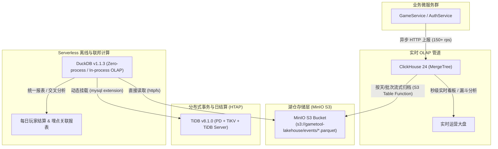

# 05. 湖仓一体分析、ClickHouse 实时数仓、TiDB 分布式数据库与 DuckDB 联邦查询实践

本文档记录在本地微服务治理体系中构建 **现代湖仓一体 (Modern Data Lakehouse) 与实时/离线统一分析架构** 的实施经验、关键技术选型与避坑指南。

---

## 一、架构设计理念：存储计算分离与湖仓统一分层

在现代游戏微服务与高并发系统中，数据分析通常面临两大痛点：
1. **实时 OLAP 延迟高、聚合慢**：传统 MySQL/PostgreSQL 面对千万级埋点日志无法秒级聚合。
2. **离线分析集群沉重昂贵**：传统 Hadoop / Spark / Presto 集群极其消耗 CPU/内存，本地或边缘场景无法轻量运行。

本项目创新性地采用了 **实时 ClickHouse + 湖仓 MinIO S3 (Parquet) + Serverless DuckDB + 分布式 HTAP TiDB** 的组合架构：



---

## 二、核心组件与职责分工

| 组件 | 版本/镜像 | 端口 | 核心角色与职责 |
| :--- | :--- | :--- | :--- |
| **ClickHouse** | `clickhouse/clickhouse-server:24-alpine` | `8123` (HTTP), `9009` (TCP) | 实时秒级高吞吐埋点摄入、实时聚合统计（充值、关卡、击杀） |
| **MinIO** | `quay.io/minio/minio:RELEASE.2024-04-18T19-09-19Z` | `9000` (API), `9001` (Web) | 本地 S3 兼容对象存储底座，保存标准 Parquet 列式湖仓文件 |
| **DuckDB** | `v1.1.3` (Host Binary) | 无守护进程 (Serverless) | 单机极速分析引擎，0 网络开销直接并行扫描 S3 Parquet 与 TiDB 数据 |
| **TiDB 集群** | `pingcap/pd`, `pingcap/tikv`, `pingcap/tidb` (v8.1.0) | `4000` (MySQL协议), `2379` (PD) | 强一致分布式 HTAP 数据库，存储玩家每日最终结算、账单事实表 |
| **可观测全家桶** | Prometheus, Jaeger, Loki, Grafana | `9090`, `16686`, `3100`, `3002` | 指标采集、分布式链路追踪、统一日志聚合与大盘可视化 |

---

## 三、关键实操与踩坑记录

### 1. ClickHouse 默认端口与 MinIO 端口冲突
- **现象**：`local-clickhouse` 容器启动报错 `Bind for :::9000 failed: port is already allocated`。
- **原因**：MinIO 默认 API 端口也是 9000，ClickHouse 原生 TCP 端口也是 9000。
- **解决方案**：将 ClickHouse 原生 TCP 端口重映射为 `9009:9000`，HTTP 接口保持 `8123:8123`。

### 2. ClickHouse S3 导出 Parquet 字段类型兼容性
- **现象**：执行 `INSERT INTO FUNCTION s3(...)` 抛出 `Internal type 'UUID' of column 'event_id' is not supported for conversion into Parquet data format`。
- **解决方案**：在 SELECT 中显式将 UUID 转换为字符串：`toString(event_id) AS event_id`，并对枚举类型转换 `toString(event_type)`。
- **覆盖写入配置**：当目标 Parquet 文件已存在时，添加 `SETTINGS s3_truncate_on_insert = 1` 即可安全覆盖更新。

### 3. DuckDB 跨源联邦分析 (Federated Query)
DuckDB 支持动态加载扩展，能够一条 SQL 穿透分布式关系型数据库与对象存储：
```sql
INSTALL httpfs; LOAD httpfs;
INSTALL mysql; LOAD mysql;

SET s3_endpoint='127.0.0.1:9000';
SET s3_access_key_id='minioadmin';
SET s3_secret_access_key='minioadmin';
SET s3_use_ssl=false;
SET s3_url_style='path';

-- 动态挂载分布式 TiDB
ATTACH 'host=127.0.0.1 port=4000 user=root database=gametool_analytics' AS tidb (TYPE mysql);

-- 跨源联合查询：TiDB 日结算表 JOIN MinIO S3 原始 Parquet 埋点
SELECT 
  t.user_id,
  t.total_recharge,
  t.max_character_level,
  s3.parquet_events_count
FROM tidb.player_daily_settlement t
LEFT JOIN (
  SELECT user_id, count(*) AS parquet_events_count
  FROM 's3://gametool-lakehouse/events/game_events_20261120.parquet'
  GROUP BY user_id
) s3 ON t.user_id = s3.user_id;
```

---

## 四、自动化运维与测试脚本

- **数据同步与报表运行**：`scripts/lakehouse-sync.sh`
- **阶段五全套组件端到端验证**：`scripts/test-phase5.sh` (21 项健康检查全部通过)
