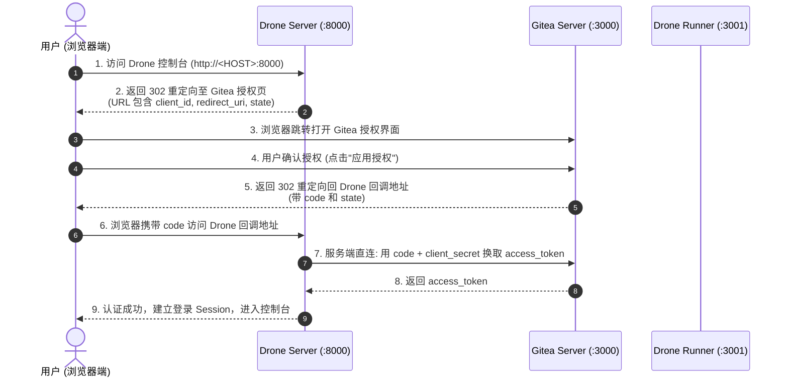

# 06. Gitea + Drone CI 部署、OAuth 2.0 联动避坑与生产主机通用落地指南

本文档沉淀了在本地及未来真实物理机/云服务器上，部署 **Gitea (代码托管) + Drone CI (轻量持续集成)** 时的完整架构设计、关键网络机制、常见深度避坑经验（DNS 无法解析、PKCE 拦截、回环防火墙拦截）以及通用生产落地模板。

---

## 一、架构全景与 OAuth 2.0 交互拓扑

Gitea 与 Drone CI 的联动基于标准 **OAuth 2.0 授权码模式 (Authorization Code Grant)**。理解其数据流是避免网络与域名配置错误的关键：



> **核心认知**：
> - **步骤 2、3、5、6**：走的是**用户终端的浏览器**，地址必须是**客户端能解析并直连的公共 IP 或域名**。
> - **步骤 7、8**：走的是 **Drone 容器到 Gitea 服务端的直连请求**。

---

## 二、三大经典踩坑剖析与根治方案 (通用避坑)

### 坑点 1：Docker 容器内部域名泄漏给浏览器 (`DNS_PROBE_FINISHED_NXDOMAIN`)

#### 1. 现象描述
在浏览器访问 Drone 点击登录，页面重定向到 `http://local-gitea:3000/login/oauth/authorize?...`，浏览器报错：
> `无法访问此网站` / `检查 local-gitea 中是否有拼写错误` / `DNS_PROBE_FINISHED_NXDOMAIN`

#### 2. 原因分析
在 `docker-compose.yml` 中配置了：
```yaml
DRONE_GITEA_SERVER=http://local-gitea:3000
```
Drone 会直接将 `DRONE_GITEA_SERVER` 的值拼接为重定向 URL 返回给用户浏览器。但 `local-gitea` 只是 Docker bridge 虚拟网卡内部的 DNS 别名，外部电脑与公网 DNS 根本无法解析该名称。

#### 3. 生产与通用主机解决方案
- **杜绝硬编码内部容器名**：`DRONE_GITEA_SERVER` 必须配置为**外部终端可解析的地址**（真实域名、局域网静态 IP 或公网 IP）。
- **生产推荐做法（反向代理与统一域名）**：
  在真实主机上，前面统一挂 Nginx 或 Traefik 反向代理，分配标准域名：
  - Gitea: `https://git.yourcompany.com`
  - Drone: `https://ci.yourcompany.com`
  配置直接写域名，无论是浏览器还是容器内，均能统一通过 DNS 正常解析。

---

### 坑点 2：OAuth 客户端类型误判与强制 PKCE 拦截 (`invalid_request`)

#### 1. 现象描述
跳转至 Gitea 时页面报错，或重定向回 Drone 时提示：
```text
http://<HOST>:8000/login/error?message=invalid_request
```
抓包或查看 Gitea 内部日志可见：
```text
invalid_request: PKCE is required for public clients
```

#### 2. 原因分析
RFC 7636 规定了两种 OAuth 客户端类型：
1. **公共客户端 (Public Client, `confidential_client = 0`)**：如单页面 JS 应用、手机 App，无法安全保管密钥。现代 Gitea 对其**强制要求 PKCE 动态挑战码**。
2. **机密客户端 (Confidential Client, `confidential_client = 1`)**：如 Drone CI 等拥有后端守护进程的服务端应用，具有独立的私密后端存储 `client_secret`。

如果通过 Gitea API 或脚本自动化创建应用时遗漏了参数，Gitea 默认会将应用存为“公共客户端”，而 Drone 并不支持也不需要 PKCE，导致 Gitea 直接以 `invalid_request` 拒绝授权。

#### 3. 生产与通用主机解决方案
- **UI 手动创建**：在 Gitea 用户设置 -> 应用 -> 创建 OAuth2 应用程序时，**务必勾选“机密客户端 (Confidential Client)”**。
- **数据库/自动化脚本修正**：
  ```sql
  UPDATE oauth2_application SET confidential_client = 1 WHERE name = 'drone';
  ```
- **RESTful API 自动化创建时明确传参**：
  ```bash
  curl -X POST http://<GITEA_HOST>/api/v1/user/applications/oauth2 \
    -H "Content-Type: application/json" \
    -d '{
      "name": "drone",
      "confidential_client": true,
      "redirect_uris": ["http://<DRONE_HOST>/login"]
    }'
  ```

---

### 坑点 3：宿主机防火墙拦截 Docker 容器回访宿主机 IP (Hairpin NAT 超时)

#### 1. 现象描述
浏览器端完成授权后，回调到 Drone 时长时间转圈或超时报错；在 Drone 容器内部 `wget http://<HOST_IP>:3000` 连接超时无响应。

#### 2. 原因分析
真实 Linux 主机通常启用了 `ufw` 或 `iptables` 防火墙。
当 Drone 容器（IP 如 `172.18.0.x`）向宿主机物理网卡 IP（如 `192.168.x.x` 或公网 IP）发起换取 Token 请求时，流量流经宿主机的 `INPUT` 链，若宿主机防火墙未显式开放对应端口，该数据包会被防火墙静默丢弃 (DROP)。

#### 3. 生产与通用主机解决方案
1. **显式放行防火墙端口**：
   ```bash
   sudo ufw allow 3000/tcp comment 'Gitea Web'
   sudo ufw allow 8000/tcp comment 'Drone Web'
   sudo ufw allow 2222/tcp comment 'Gitea SSH'
   ```
2. **容器间网络优化 (推荐)**：
   若处于同一 Docker 网络，可以利用 Nginx 反代或使用环境变量让内部服务走专用内网互通，但对于 OAuth 模式，最简单稳健的方式是确保宿主机防火墙端口对外及对容器网段均处于开放状态。

---

## 三、真实主机通用部署配置文件模板 (Production Template)

为方便后续在任意真实物理机或云服务器上一键复用，提供以下**参数解耦、支持环境变量**的标准编排模板：

### 1. 环境变量配置文件 `.env`
在部署目录创建 `.env`，更换实际 IP 或域名即可：
```ini
# 宿主机外部访问 IP 或域名（必须是浏览器能直接访问到的地址）
SERVER_HOST=192.168.137.240

# Gitea 对外基础 URL
GITEA_URL=http://${SERVER_HOST}:3000
GITEA_PORT=3000
GITEA_SSH_PORT=2222

# Drone 对外基础 URL
DRONE_HOST=${SERVER_HOST}:8000
DRONE_PORT=8000

# 通信密钥 (部署前请执行 openssl rand -hex 16 重新生成)
DRONE_RPC_SECRET=fa8974a9b2c3d4e5f60718293a4b5c6d

# Gitea OAuth2 凭证 (在 Gitea 创建应用后填入)
DRONE_GITEA_CLIENT_ID=your_client_id_here
DRONE_GITEA_CLIENT_SECRET=your_client_secret_here
```

### 2. 标准 `docker-compose.yml`
```yaml
services:
  gitea:
    image: gitea/gitea:1.22
    container_name: gitea
    restart: always
    environment:
      - USER_UID=1000
      - USER_GID=1000
      - GITEA__security__INSTALL_LOCK=true
      - GITEA__server__ROOT_URL=${GITEA_URL}/
      - GITEA__server__DOMAIN=${SERVER_HOST}
      - GITEA__server__HTTP_PORT=3000
      - GITEA__server__SSH_PORT=${GITEA_SSH_PORT}
    ports:
      - "${GITEA_PORT}:3000"
      - "${GITEA_SSH_PORT}:22"
    volumes:
      - gitea_data:/data

  drone-server:
    image: drone/drone:2
    container_name: drone-server
    restart: always
    ports:
      - "${DRONE_PORT}:80"
    environment:
      - DRONE_SERVER_HOST=${DRONE_HOST}
      - DRONE_SERVER_PROTO=http
      - DRONE_RPC_SECRET=${DRONE_RPC_SECRET}
      - DRONE_GITEA_SERVER=${GITEA_URL}
      - DRONE_GITEA_CLIENT_ID=${DRONE_GITEA_CLIENT_ID}
      - DRONE_GITEA_CLIENT_SECRET=${DRONE_GITEA_CLIENT_SECRET}
      - DRONE_USER_CREATE=username:gitea_admin,admin:true
      - DRONE_OPEN=true
      - DRONE_DATABASE_DRIVER=sqlite3
      - DRONE_DATABASE_DATASOURCE=/data/drone.sqlite
    volumes:
      - drone_data:/data
    depends_on:
      - gitea

  drone-runner:
    image: drone/drone-runner-docker:1
    container_name: drone-runner
    restart: always
    ports:
      - "3001:3000"
    environment:
      - DRONE_RPC_PROTO=http
      - DRONE_RPC_HOST=drone-server
      - DRONE_RPC_SECRET=${DRONE_RPC_SECRET}
      - DRONE_RUNNER_CAPACITY=2
      - DRONE_RUNNER_NAME=production-runner
    volumes:
      - /var/run/docker.sock:/var/run/docker.sock
    depends_on:
      - drone-server

volumes:
  gitea_data:
  drone_data:
```

---

## 四、真实主机上线标准部署自检清单 (Checklist)

在任何新物理机或云服务器上部署时，按此清单执行可保证 100% 一次性成功：

- [ ] **1. 防火墙配置**：确认宿主机防火墙允许 `3000` (Gitea Web)、`8000` (Drone Web) 及 `2222` (SSH) 端口入站。
- [ ] **2. 统一对外地址**：确认 `.env` 中的 `SERVER_HOST` 为真实物理机 IP 或解析到该机器的公网域名，严禁使用 `localhost` 或 Docker 容器别名（如 `local-gitea`）。
- [ ] **3. 启动 Gitea 并创建机密应用**：
  - 启动 Gitea 后登录 Web 界面。
  - 在管理员设置 -> 应用中新建应用，**必选“机密客户端 (Confidential Client)”**，重定向 URI 填写 `http://${DRONE_HOST}/login`。
- [ ] **4. 将凭证同步写入 Drone 并启动**：将生成的 Client ID 与 Secret 填入 `.env`，执行 `docker compose up -d` 启动 Drone。
- [ ] **5. 全链路闭环验证**：在另一台客户端电脑浏览器访问 `http://${DRONE_HOST}/login`，验证能正常跳转 Gitea 授权并回跳至 Drone 控制台。
