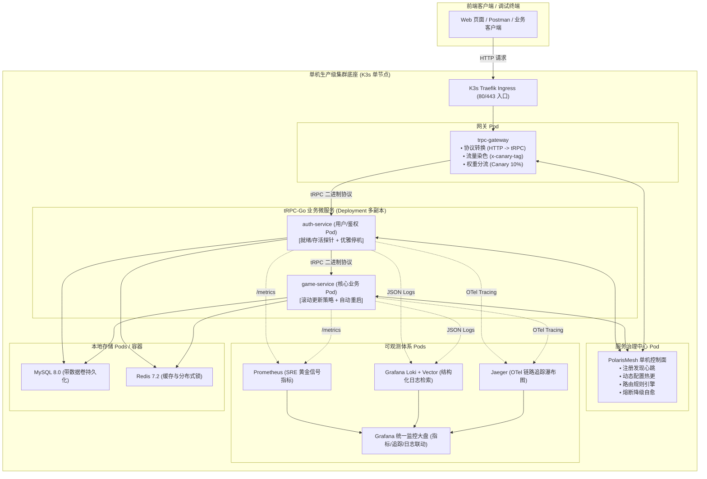

# 本地部署“偏向生产环境”的技术选型决策指南 (Local-to-Production Parity)

> **文档版本**：v1.0.0  
> **制定日期**：2026-11-19  
> **核心定位**：针对“在本地机器部署微服务与治理体系，但架构和工具选型全面向**生产级标准（生产同构、生产级治理规范、零改动平滑上线）**看齐”的需求，提供兼顾**单机资源可行性**与**生产级能力闭环**的技术选型决策矩阵。

---

## 一、 为什么本地部署需要“偏向生产环境”（生产同构设计原则）

在传统软件研发中，最大的痛点是 **“本地能跑，线上崩掉”**（例如本地写死 IP 通信、缺乏真实的健康探针、配置改动靠重启、无真实链路追踪与灰度机制）。

本方案坚持 **“生产同构（Production Parity）”** 的核心设计原则：
1. **协议与治理同构**：本地采用与生产环境完全相同的 tRPC 二进制协议、Protobuf 契约、北极星服务注册心跳、动态配置热更新与流量染色路由规则。
2. **编排范式同构**：采用标准 Kubernetes 声明式 API（Deployment, Service, Ingress, ConfigMap, Health Probe），本地编写的 Helm 模板与上线脚本直接 100% 复用到云上生产集群。
3. **可观测同构**：SRE 黄金监控信号（Prometheus）、OpenTelemetry 分布式链路追踪（Jaeger）、JSON 结构化日志（Loki）与 Trace-to-Log 一键联动在本地完整跑通。
4. **单机自闭环与资源可控**：整体架构严格控制在单台开发机（16GB 内存物理机，预估占用 3.5~4.5GB），无外部云平台强依赖。

---

## 二、 偏向生产环境的本地部署技术选型决策矩阵

| 架构治理领域 | 偏向生产推荐选型 (方案 A) | 常见玩具/极简选型 (方案 B) | 为什么生产偏向选型更优？（深度权衡说明） |
|---|---|---|---|
| **1. 容器集群编排** | **K3s (单机轻量级 Kubernetes)** | Docker Compose | • **K3s 具备真正的生产级标准**：原生支持 Deployment 滚动更新策略、PreStop 优雅停机、Liveness/Readiness 探针与 Service DNS 服务发现。 • 本地编写的 Helm Charts / YAML 可直接无缝交付线上生产，避免二次重构。 • 内存开销仅 ~600MB，单机完全吃得消。 |
| **2. 服务治理中心** | **PolarisMesh (北极星单机/轻量版)** | Consul / 简单静态配置 | • **tRPC-Go 官方原生同构**：本地单容器即具备完整的生产级功能（真实服务注册心跳、配置热更新、流量染色标签路由、金丝雀权重分流、Sentinel 熔断降级）。 • 代码直接引入官方生产级插件（`trpc-naming-polaris`），无需自研任何胶水适配。 |
| **3. API 接入网关** | **trpc-gateway (容器化部署)** | 普通 Nginx 反向代理 | • **深度契约与协议转换**：能直接解析 Protobuf，将外部 HTTP/JSON 请求动态路由并转为内部 tRPC RPC 协议。 • 原生透传北极星治理标签（Canary Tag 与 TraceID 上下文），与微服务网格无缝协同。 |
| **4. 质量指标监控** | **Prometheus + Grafana** | 无监控 / 纯靠本地终端打日志 | • **生产同款 SRE 黄金信号**：微服务通过 `trpc-metrics-prometheus` 插件自动暴露 `/metrics`，Prometheus 定时采集。 • Grafana 搭建生产同款微服务质量大盘（监控接口成功率 > 99.5%、P99/P95 耗时、QPS、5xx 错误率、Goroutine 泄漏）。 |
| **5. 分布式链路追踪** | **OpenTelemetry SDK + Jaeger (All-in-one)** | 仅靠日志打印 print trace | • **生产级 Trace 规范**：全链路采用 OpenTelemetry 国际标准，Gateway 注入 W3C TraceContext，tRPC-Go 拦截器自动跨进程透传。 • 本地 Jaeger 提供直观的调用瀑布图，秒级定位跨服务慢 RPC 或慢 SQL。 |
| **6. 结构化日志系统** | **Vector + Grafana Loki + Grafana** | 传统重型 ELK 或仅标准输出 | • **生产级流式日志思路**：按 Label 建立轻量索引，与重型 Elasticsearch（动辄吃 3~4G 内存）相比，Loki 内存仅需 ~300MB。 • 在 Grafana 中实现生产级 **Trace-to-Log 一键联动**（点击 TraceID 直接跳转查看该请求的全链路微服务日志）。 |
| **7. 契约驱动研发** | **Protobuf IDL + buf (lint & breaking) + trpc-cmd** | 手写接口文档 / 随意加减字段 | • **Schema as Code 生产规范**：以 Proto 作为唯一事实来源，强制执行向下兼容检查（禁止删除已有 tag），一键生成后端 Go 桩代码与前端 TypeScript SDK / Mock Server。 |
| **8. 流水线与质量门禁** | **本地标准化 Makefile + Git Pre-push Hook** | 手动 `go run` / 无校验 | • **生产 CI 门禁本地化**：提交前自动触发 `make lint` (golangci-lint + buf lint) 与 `make test` (单测覆盖率 $\ge$ 70%)，杜绝低级错误推送到主仓。 |
| **9. 基础存储中间件** | **MySQL 8.0 容器 + Redis 7.2 容器 (持久化卷)** | SQLite / 内存 Mock 缓存 | • 真实模拟生产级关系数据库与分布式缓存环境，验证真实连接池、慢 SQL、事务与分布式锁。 |

---

## 三、 本地偏向生产架构拓扑与数据流图

---

## 四、 本地资源预算核算（实测 16GB 宿主机）

| 组件模块 | 推荐选型 | 预估内存占用 | 预估 CPU 占用 | 偏向生产的特性保障 |
|---|---|---|---|---|
| **集群控制面与网络** | K3s (含 Flannel CNI & CoreDNS) | 500 ~ 700 MB | 0.2 ~ 0.5 核 | 完整的 K8s API、Pod 探针与服务滚动更新 |
| **服务治理控制面** | PolarisMesh 容器 | 400 ~ 550 MB | 0.2 ~ 0.4 核 | 生产同款注册发现心跳、配置热更与动态路由规则 |
| **微服务网关** | trpc-gateway | 150 ~ 250 MB | 0.1 ~ 0.3 核 | 原生 Protobuf 契约解析与 tRPC 协议转换 |
| **链路追踪** | Jaeger All-in-one | 250 ~ 350 MB | 0.1 ~ 0.2 核 | 生产级 OpenTelemetry 链路透传与瀑布图 |
| **质量指标监控** | Prometheus + Grafana | 400 ~ 550 MB | 0.2 ~ 0.4 核 | SRE 黄金信号指标采集与服务大盘 |
| **日志检索系统** | Grafana Loki + Vector | 300 ~ 450 MB | 0.1 ~ 0.3 核 | 结构化 JSON 日志检索与 Trace-to-Log 联动 |
| **存储中间件** | MySQL 8.0 + Redis 7.2 | 800 ~ 1100 MB | 0.2 ~ 0.5 核 | 生产同构关系数据库与缓存 |
| **业务服务 (3~4个 Pod)** | tRPC-Go 微服务多副本 | 400 ~ 700 MB | 0.3 ~ 0.8 核 | 包含鉴权服务、业务服务等样例服务 |
| **全套汇总** | - | **约 3.2 ~ 4.6 GB** | **约 1.5 ~ 3.5 核** | **宿主机可用 12GB，余量高达 7GB+，毫无压力** |

---

## 五、 实施建议与下一步决议

若认同 **“本地部署偏向生产环境”** 的技术路线：
1. **底座确认**：本地采用 **K3s** 作为集群编排底座（比 Docker Compose 规范得多，能真正验证探针、滚动发布、Service 发现与 Helm 交付）。
2. **治理确认**：采用 **PolarisMesh + trpc-gateway** 作为服务治理与网关接入（与 tRPC 生态同源且功能完备）。
3. **可观测确认**：采用 **Prometheus + Grafana + Loki + Jaeger**（兼顾轻量化与生产级 Trace-to-Log 联动体验）。
