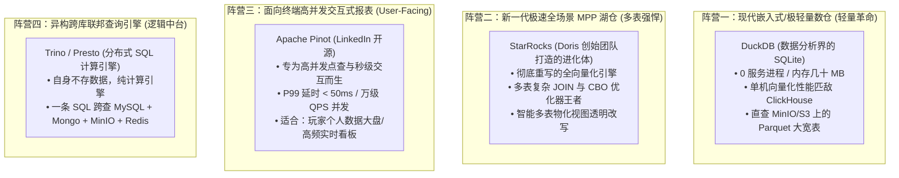

# 现代实时数仓与 OLAP 引擎全景图：除了 Doris 与 ClickHouse，还有哪些更好的选择？

> **核心提问**：除了 Apache Doris 和 ClickHouse，市面上还有没有其它更好、更具优势的数仓与分析型数据库选择？

---

## 一、 现代分析型数仓全景四大阵营

在当前大数据与云原生领域，“更好”的定义因场景而异（是追求**极限轻量**、**多表复杂关联**、**超高并发交互**，还是**跨库联邦查询**）。除了 Doris 和 ClickHouse，业界公认的顶尖选择主要分布在以下四大阵营：



---

## 二、 核心候选者深度横向对比

| 引擎名称 | 核心设计哲学 | 单机内存开销 | 相比 ClickHouse / Doris 的最大优势 | 局限性与不足 | 最适合业务场景 |
|---|---|---|---|---|---|
| **DuckDB**<br>⭐⭐⭐⭐⭐<br>(本地与开发神作) | **进程内嵌入式 OLAP**<br>(数据分析领域的 SQLite) | **几十 MB ~ 200MB**<br>(随进程使用，极省) | • **0 独立常驻服务**，零运维网络开销<br>• 极速单机向量化计算（不输 CH）<br>• **原生直接查询 MinIO/S3 上的 Parquet**<br>• 原生无缝直连 MySQL/PostgreSQL 外部表 | 不支持分布式多机横向水平扩展（只专注单机极速分析，但单机可撑百 GB 数据） | • 微服务内部即席聚合<br>• 配合 MinIO 的极简数仓闭环<br>• 本地开发与单机测试 |
| **StarRocks**<br>⭐⭐⭐⭐⭐<br>(企业级全能王) | **新一代全场景 MPP**<br>(原 Doris 核心团队进化体) | **~3 GB ~ 6 GB**<br>(FE + BE 架构) | • **多表复杂关联 (JOIN) 性能断崖式领先**<br>• 业界最强智能多表物化视图（透明查询改写）<br>• 原生极速外表分析（Iceberg/Hudi/MySQL） | 单机运行偏重，对内存要求较高，依赖 Java FE 与 C++ BE 集群架构 | • 包含大量订单、用户、道具多表复杂联查的企业生产中台<br>• 实时湖仓一体分析 |
| **Apache Pinot**<br>⭐⭐⭐⭐<br>(高并发点查) | **面向用户的交互式分析**<br>(User-Facing Analytics) | **~2 GB ~ 4 GB** | • **极限低延时与高 QPS 并发**（支持千到万级并发查询，P99 < 50ms）<br>• 适合面向 C 端玩家/用户展示自身报表 | 不支持复杂的任意多表 JOIN，需要将数据预先打平成大宽表 | • 游戏内玩家个人赛季战绩大盘<br>• 电商用户个人账单与高频实时风控 |
| **Trino**<br>(PrestoSQL)<br>⭐⭐⭐⭐ | **异构数据联邦查询**<br>(Federated Query) | **~1.5 GB ~ 3 GB** | • **一条 SQL 跨越所有存储**：`SELECT * FROM mysql.users u JOIN mongo.profiles p JOIN minio.logs l` | 自身不提供存储，查询性能严重受限于底层存储介质的读取带宽 | • 异构数据源统一即席查询入口<br>• 避免数据频繁搬移搬运的逻辑数据湖 |
| **ClickHouse**<br>(已定稿对比项) | **极限单表大宽表列式计算** | **~400 MB**<br>(纯 C++) | • 纯 C++ 单容器，单机轻量极速<br>• 针对亿级日志流水大宽表单表查询性能无敌 | 多表复杂 JOIN 相对较弱；高频单条数据更新（Mutation）代价大 | • 游戏日志对局流水、海量行为埋点大宽表、留存漏斗 |
| **Apache Doris**<br>(已定稿对比项) | **一体化极速实时数仓** | **~3 GB ~ 5 GB** | • 100% 兼容 MySQL 协议，无缝接入各类 BI 工具<br>• 支持高频实时行级 Upsert（更新友好） | 单机偏重，FE 依赖 Java JVM，单机吞吐极限略低于 ClickHouse 纯单表 | • 业务报表包含频繁状态变更（如订单状态流转、用户积分更新） |

---

## 三、 两大最具颠覆性的“更好选择”深度剖析

在上述列表中，有两个选择在当今业界最受瞩目，非常值得重点关注：

### 1. 颠覆性轻量神作：DuckDB —— “本地开发与云原生微服务的绝配”
- **为什么说它是近两年全球最火爆的分析黑马？**
  - 在传统观念中，“搞数仓”就意味着要拉起一整套沉重的数据库集群（ZooKeeper、Broker、FE、BE、ClickHouse-Server），吃掉几 GB 内存；
  - **DuckDB 彻底颠覆了这一点**：它是一个只有十几 MB 的 C++ 动态链接库或单文件 CLI。**零后台服务、零网络监听**；
- **在当前 tRPC-Go + MinIO 架构下的“降维打击”玩法**：
  1. tRPC-Go 业务服务将游戏对局流水、埋点日志，微批次压缩写入 **MinIO 对象存储**（存为标准 Parquet 列存文件）；
  2. 需要出复杂报表时，报表服务只需引入 DuckDB，**直接执行 SQL 查 MinIO 上的 Parquet 文件**：
     ```sql
     -- DuckDB 原生挂载 MinIO 直接跨文件秒级查询百万行数据
     INSTALL httpfs; LOAD httpfs;
     SET s3_endpoint='127.0.0.1:9000';
     SET s3_access_key_id='minioadmin';
     SET s3_secret_access_key='minioadmin';

     SELECT channel, count(*), sum(pay_amount) 
     FROM read_parquet('s3://game-logs/2026/11/*.parquet') 
     GROUP BY channel;
     ```
  3. **结果**：微秒级响应，而且**不需要在宿主机常驻任何数仓后台进程**！

### 2. 企业级生产全能王：StarRocks —— “Doris 的全面进化版”
- **它是怎么超越传统数仓的？**
  - StarRocks 是原 Doris 团队于 2020 年重组打造的下一代产品，核心执行引擎全量采用现代 C++ 向量化技术重写，并自研了性能强悍的 Cost-Based Optimizer (CBO)；
  - **在多表 JOIN 场景下**：ClickHouse 在多表关联时经常需要依赖复杂的分布式 Join 调优，而 StarRocks 支持 Colocate Join、Broadcast Join、Shuffle Join，能够直接处理数十张表动态复杂关联；
  - **自动多表物化视图**：业务写一个原表的复杂聚合查询，StarRocks 自动在后台异步维护物化视图并实现透明加速，查询提速数十倍。

---

## 四、 针对当前项目的最终选型决策建议

结合当前**本地 16GB 物理机宿主机环境**与**未来线上生产环境**：

```text
                                  【数据分析与数仓场景决策】
                                              │
                    ┌─────────────────────────┴─────────────────────────┐
                    ▼                                                   ▼
         【本地开发 / 单机轻量交付】                             【未来大规模生产环境集群】
                    │                                                   │
         ┌──────────┴──────────┐                             ┌──────────┴──────────┐
         ▼                     ▼                             ▼                     ▼
    【首选方案 A】        【备选方案 B】                 【首选方案 A】        【备选方案 B】
  直接 MySQL / Prometheus    ClickHouse                     StarRocks              DuckDB + Lakehouse
 (现有套件 0 额外内存开销) (单机纯C++仅400MB，大宽表王者) (全场景强悍多表JOIN，生产天花板) (云端 S3/COS 湖仓极简架构)
```

1. **单机资源最优雅解**：
   - 如果您希望既不需要部署沉重集群、又想具备现代化高速列存分析体验，**DuckDB + MinIO** 是最现代化、最干净的组合；
2. **需要独立后台服务与 Grafana 官方插件大盘**：
   - **ClickHouse** 依然是单容器资源开销最小（~400MB）、单表大宽表性能最残暴的单兵之王；
3. **如果是未来公司级线上大规模生产集群，且多表复杂 JOIN 极多**：
   - 生产环境建议考虑 **StarRocks**（替代 Doris 的企业级首选）。
