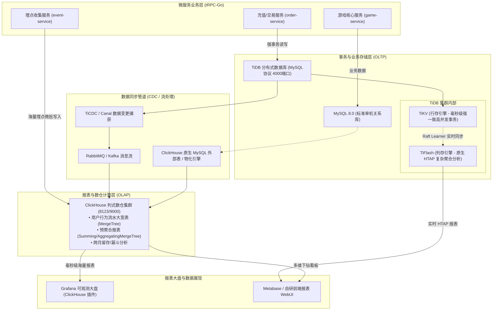

# TiDB + ClickHouse 复杂报表与实时数仓架构设计方案

## 一、 为什么复杂报表需要引入 TiDB + ClickHouse？

在微服务业务初期，所有报表往往直接在业务主库（如 MySQL 8.0）上执行 `COUNT`、`SUM`、`GROUP BY` 和多表 `JOIN`。然而随着业务规模和用户行为数据（游戏日志、埋点事件、对账流水）持续膨胀，传统方案迅速暴露痛点：

1. **OLTP 业务主库被慢查询拖垮**：报表查询动辄扫描百万至上千万行记录，导致 CPU 飙升、连接池耗尽，甚至锁表引发线上交易超时崩溃；
2. **单表千万级瓶颈**：单表超过两千万行后，B+ Tree 索引深度增加，写入和复杂查询性能断崖式下跌；
3. **多维动态聚合迟钝**：游戏业务常见运营多维下钻（按渠道、区服、时间窗、等级段交叉过滤留存与 LTV 漏斗），行存数据库天然不适合列式压缩与向量化批量计算。

为此，引入 **TiDB (分布式 HTAP) + ClickHouse (极致列式 OLAP)** 构建现代化双引擎报表中台体系。

---

## 二、 核心组件定位与职能分工

| 核心组件 | 定位与类型 | 擅长场景与报表职能 | 内存开销 (单机) |
|---|---|---|---|
| **TiDB** (PingCAP) | 分布式 NewSQL / HTAP 混合事务分析 | • 兼容 MySQL 5.7/8.0 协议，微服务应用无需修改代码<br>• 单表过亿海量事务，解决分库分表运维痛苦<br>• 内建 **TiFlash** 列存引擎，原生实现 HTAP（一处写入，行存保证交易，列存强一致秒级出报表） | ~1.4 GB (PD+TiKV+TiDB) |
| **ClickHouse** | 极致 OLAP 列式数仓 | • 专为万亿级海量大宽表多维聚合查询而生<br>• 向量化执行引擎（SIMD），单机每秒处理上亿行数据<br>• 超高列式压缩比（5~10 倍），大幅削减存储成本<br>• 游戏埋点、行为流水、留存率、LTV、充值漏斗秒级展现 | ~400 MB |

---

## 三、 TiDB + ClickHouse 协同架构蓝图



---

## 四、 两种典型数据流转模式

### 模式 A：TiDB 内部闭环（极简 HTAP 方案）
- **适用场景**：订单、财务明细、核心用户表的复杂联表统计；
- **实现方式**：
  1. 开启 TiDB 的 TiFlash 副本：`ALTER TABLE orders SET TIFLASH REPLICA 1;`
  2. 业务日常读写走 TiKV 行存；
  3. 执行耗时跨月汇总量查询时，TiDB 优化器自动将计算下推到 TiFlash 列存并行扫描；
  4. **核心优势**：零 ETL，零数据同步链路，100% 强一致性。

### 模式 B：TiDB/MySQL + ClickHouse 异构联动（海量行为数仓方案）
- **适用场景**：亿级游戏对局日志、用户点击流、留存漏斗、长周期历史大宽表分析；
- **实现方式**：
  1. ClickHouse 创建 `MergeTree` 引擎大宽表；
  2. 微服务事件或 CDC 管道将增量数据实时批量落入 ClickHouse；
  3. 利用 ClickHouse 的 `Engine = MySQL(...)` 外部表与本地大宽表直接执行 `GLOBAL JOIN`，实现业务主数据与行为流水无缝联表；
  4. **核心优势**：极致查询速度，即使数百亿行数据也能秒级出图。

---

## 五、 本地单机资源与部署指南

已为复杂报表套件提供专用的编排配置：`deploy/docker-compose.analytics.yml`。

### 1. 端口与资源开销

| 容器服务 | 镜像 | 映射端口 | 默认账号密码 | 内存建议 |
|---|---|---|---|---|
| **ClickHouse** | `clickhouse/clickhouse-server:24-alpine` | `8123` (HTTP/Web), `9000` (Native) | 默认无密码 / `default` | ~400 MB |
| **TiDB PD** | `pingcap/pd:v8.1.0` | `2379` (Client/Dashboard) | - | ~150 MB |
| **TiDB TiKV** | `pingcap/tikv:v8.1.0` | `20160` (内部通信) | - | ~500 MB |
| **TiDB Server** | `pingcap/tidb:v8.1.0` | `4000` (MySQL协议), `10080` (监控) | `root` (默认无密码) | ~500 MB |

### 2. 快速启动与停止

使用 Makefile 快捷指令：
```bash
# 启动复杂报表与数仓套件
make analytics-up

# 停止套件
make analytics-down
```

### 3. 连接与验证

- **ClickHouse HTTP Web 查询端点**：
  浏览器直接访问：`http://localhost:8123/play`
  命令行测试：
  ```bash
  curl 'http://localhost:8123/' --data-binary 'SELECT version(), current_database();'
  ```
- **TiDB MySQL 协议连接**：
  使用标准 MySQL 客户端直接连 4000 端口：
  ```bash
  mysql -h 127.0.0.1 -P 4000 -u root
  ```
- **ClickHouse 外部表直连 TiDB/MySQL 示例**：
  ```sql
  -- 在 ClickHouse 中直接建立 TiDB 外部映射表
  CREATE TABLE ch_tidb_orders
  (
      order_id UInt64,
      user_id UInt64,
      amount Decimal(10, 2),
      created_at DateTime
  ) ENGINE = MySQL('127.0.0.1:4000', 'gametool', 'orders', 'root', '');

  -- 直接在 ClickHouse 里秒级查询 TiDB 业务数据
  SELECT count(), sum(amount) FROM ch_tidb_orders;
  ```
