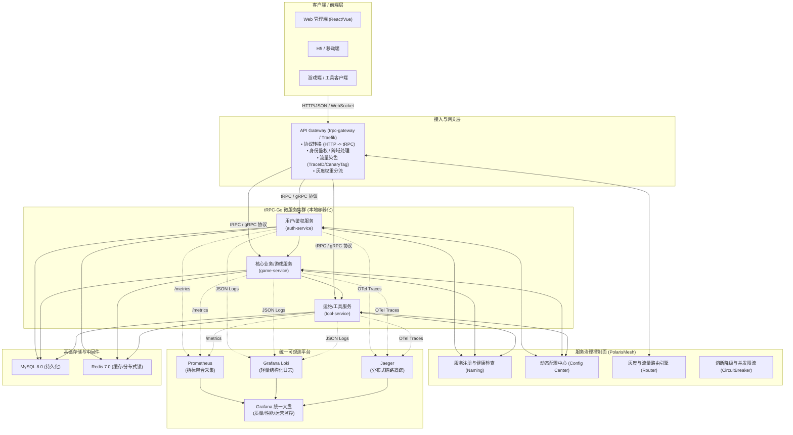
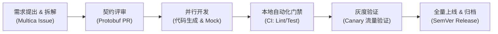
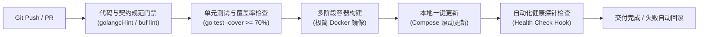
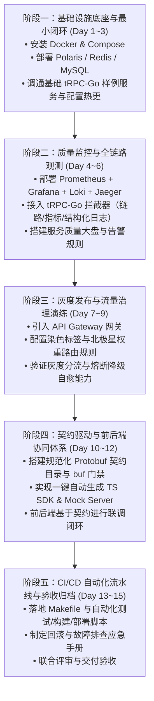

# 本地部署全套 tRPC-Go 微服务与生产级治理体系实施方案与沟通指南

> **文档版本**：v1.0.0  
> **制定日期**：2026-11-19  
> **关联任务**：GAMETOOL-3 (本地部署全套微服务)  
> **适用范围**：本地开发/测试环境及生产同构架构规划  

---

## 1. 项目背景与总体目标

### 1.1 背景
为了满足高并发、微服务化以及团队高质高效协同的需求，团队计划在本地环境搭建一套基于 **tRPC-Go** 的全套微服务底座与生产级治理体系。tRPC-Go 作为腾讯开源的高性能多协议 RPC 框架，具备插件化、高性能、多协议（tRPC/gRPC/HTTP 等）无缝互通等优势。

本方案旨在回答如何在资源有限的**本地化/私有环境**中，构建一套兼顾**生产级规范**与**开发调试友好性**的完整研发生态，涵盖需求生命周期、契约版本、灰度分流、全链路追踪、监控告警、前后端协同以及 CI/CD 自动化流水线。

### 1.2 核心目标与建设原则
1. **生产同构（Production Parity）**：本地采用轻量化中间件，但治理机制（路由、拦截器、协议、元数据透传、指标格式）与生产环境 100% 保持一致，杜绝“本地正常、上线异常”。
2. **轻量闭环（Self-Contained & Lightweight）**：整体体系在单台物理机/开发机（8~16GB 内存）上自闭环运转，无外部云平台强依赖，支持全流程离线调试。
3. **契约即代码（Schema as Code）**：以 Protobuf IDL 作为唯一事实来源（Single Source of Truth），实现前后端代码、校验规则、接口文档的自动化衍生。
4. **全方位可观测（Full Observability）**：日志、指标、追踪三位一体，分钟级定位故障与性能瓶颈。

---

## 2. 总体架构蓝图

系统整体采用“流量接入网关 + tRPC-Go 微服务网格 + PolarisMesh 治理底座 + 统一可观测性平台”的层次化架构。



---

## 3. 核心治理板块与落地方案

### 3.1 需求管理与版本迭代全生命周期



1. **需求规范化（Issue-driven）**：
   - 依托 Multica 敏捷看板，所有开发均以 Issue Key 为凭据。
   - 状态流转严格受控：`todo`（待排期） $\rightarrow$ `in_progress`（开发/联调） $\rightarrow$ `in_review`（代码评审/验证） $\rightarrow$ `done`（验收归档）。
2. **分支管理模型**：
   - 主干保护（Trunk-based 或 GitHub Flow）：`main` 始终处于随时可交付状态。
   - 特性分支：`feat/GAMETOOL-3-xxx`，修复分支：`fix/GAMETOOL-3-xxx`。
   - 发布分支：`release/vX.Y.Z`，打标准 Git Tag。
3. **语义化版本规范（SemVer 2.0）**：
   - **主版本号 (Major)**：存在不兼容的 API 变更或架构重构（如 `v1` $\rightarrow$ `v2`）。
   - **次版本号 (Minor)**：向下兼容的功能性新增（如新增接口或非必填字段）。
   - **修订号 (Patch)**：向下兼容的 Bug 修复与性能调优。

---

### 3.2 接口契约与前后端协同管理 (Schema as Code)

1. **唯一事实来源（Protobuf IDL）**：
   - 建立统一的契约仓（或微服务统一契约目录 `api/proto/`）。
   - 规范接口包命名：`package trpc.gametool.user.v1;`。
2. **契约校验门禁**：
   - 引入 `buf lint` 强制命名规范（camelCase、蛇形命名等）。
   - 引入 `buf breaking --against` 强制向下兼容检查，严禁删除字段编号、修改已有字段类型。
3. **自动化衍生流水线**：
   - **后端代码**：通过 `trpc-cmd` / `protoc` 一键生成 tRPC-Go 服务的骨架代码、RPC 桩代码与验证器代码。
   - **前端 SDK**：通过 `ts-proto` / `protoc-gen-ts` 自动生成 TypeScript 强类型接口定义和 HTTP 请求函数，杜绝手动对齐字段带来的低级拼写 Bug。
   - **接口文档与 Mock**：自动输出 OpenAPI/Swagger JSON，一键导入 Mock 平台，前端无需等待后端即可根据契约开发联调。

---

### 3.3 灰度控制与流量治理体系

为实现生产级别的渐进式发布，在本地部署中建立两级灰度控制能力：

1. **流量染色机制（Traffic Coloring）**：
   - 网关层根据请求特征（HTTP Header 如 `x-traffic-env: canary`，或特定测试用户 Cookie/UID）对请求进行染色，打入 tRPC 上下文元数据（`metadata`）。
   - tRPC-Go 框架内置拦截器在跨服务 RPC 调用时，自动透传染色标签，保证整个调用链路流经对应的灰度实例（环境隔离/泳道机制）。
2. **权重分流（Weighted Canary）**：
   - 在 PolarisMesh 中配置按权重的服务路由规则（如 Stable 节点 90%，Canary 节点 10%）。
   - 网关层与 tRPC 客户端负载均衡器动态读取北极星路由规则，自动进行平滑流量切换。
3. **熔断与优雅降级**：
   - 配置 tRPC-Go Sentinel / Polaris 熔断器插件。
   - 当灰度版本接口的错误率超过 20% 或 P99 耗时异常飙高时，触发熔断器自动熔断，流量降级切回稳定版本，保护整体服务不雪崩。

---

### 3.4 全方位质量监控体系 (Quality & SLO)

建立基于 Google SRE 黄金信号（Golden Signals）的质量指标监控：

| 监控维度 | 关键指标 | 采集方式 | 告警触发阈值 (参考) |
|---|---|---|---|
| **可用性 (Availability)** | 接口成功率 (Success Rate) | tRPC-Go 内置 Prometheus 插件 | 成功率 < 99.5% 触发 P1 告警 |
| **错误率 (Error Rate)** | 5xx 占比 / 业务错误码分布 | tRPC Server Filter 自动打点 | 5xx 突增 > 1% 触发 P0 告警 |
| **延迟 (Latency)** | 接口 P50 / P90 / P99 耗时 | Prometheus Histogram 指标 | P99 > 800ms 持续 1 分钟触发告警 |
| **吞吐量 (Throughput)** | QPS、并发连接数 | Prometheus Counter 指标 | 出现断崖式下跌或突增 300% 告警 |
| **系统资源 (Saturation)** | CPU、内存、Goroutine、连接池 | Go Runtime 探针 + Node Exporter | CPU > 85% 或 Goroutine 泄漏告警 |

---

### 3.5 分布式链路追踪 (Distributed Tracing)

1. **链路追踪标准**：全面接入 **OpenTelemetry (OTel)** 标准。
2. **全链路透传设计**：
   - **入口生成**：网关层针对每个外来请求生成唯一的 `TraceID`（若上游未携带），并遵循 W3C TraceContext 规范。
   - **框架自动传播**：tRPC-Go 接入 `trpc-filter/opentelemetry`，在服务端拦截器与客户端拦截器自动提取和注入 Trace 上下文，涵盖：
     - RPC 请求耗时与响应状态
     - Redis / MySQL SQL 执行时长与慢查询标记
     - 业务自定义打点 Span
3. **链路存储与可视化**：
   - 本地部署轻量级 **Jaeger**（All-in-one 单机容器镜像）。
   - 提供直观的调用瀑布图（Waterfall），精准定位哪一个 RPC 节点或慢 SQL 拖慢了整体耗时。

---

### 3.6 结构化日志监控体系 (Logging)

1. **结构化 JSON 日志规范**：
   统一所有微服务日志输出格式，包含标准元数据：
   ```json
   {
     "timestamp": "2026-11-19T20:45:00.123+08:00",
     "level": "INFO",
     "service": "game-service",
     "env": "local",
     "trace_id": "4bf92f3577b34da6a3ce929d0e0e4736",
     "span_id": "00f067aa0ba902b7",
     "caller": "logic/player.go:88",
     "msg": "player login success",
     "user_id": 10086,
     "cost_ms": 12.4
   }
   ```
2. **轻量化采集与存储选型**：
   - 弃用笨重耗内存的传统 ELK（Elasticsearch 通常需 4G+ 内存），选型采用 **Grafana Loki + Vector/Promtail**。
   - 内存开销仅 ~300MB，支持高效索引标签和海量文本流式检索。
3. **Trace-to-Log 联动**：
   - 在 Grafana 中打通 Jaeger 与 Loki：查看链路追踪 Span 时，一键跳转查看该请求在各服务打印的所有上下文日志。

---

### 3.7 业务运营数据监控 (Business Metrics & APM)

1. **运营关键指标沉淀**：
   - 用户与业务域：实时活跃玩家数、房间并发数、道具流转频率、交易成功率。
   - 系统治理域：各版本流量占比、灰度版本转化率、长尾慢接口 Top 10。
2. **大盘落地（Grafana 业务看板）**：
   - 提供独立维度的业务运营 Dashboard。
   - 支持按时间范围、环境、版本、租户等标签动态过滤与下钻。

---

### 3.8 流水线构建与自动化交付 (CI/CD Pipeline)



1. **本地自动化执行工具链**：
   - 提供标准化 `Makefile` / 本地 Runner 脚本。
   - 执行 `make lint`、`make test`、`make proto`、`make build`、`make deploy`。
2. **安全防护门禁**：
   - 单测覆盖率不达标（如 < 70%）阻断发布。
   - 静态检查存在 error 阻断发布。
   - 启动后若健康检查接口连续 3 次失败，自动执行 `docker compose rollback` 恢复上一稳定版本。

---

## 4. 本地环境基础设施与资源预算规划

当前本地开发机环境为：**Ubuntu 24.04 (Linux 7.0 内核), 16GB 内存, 300GB 硬盘空间**。

### 4.1 容器与中间件资源分配预算

| 模块组件 | 技术选型 | 容器化方式 | 预估内存占用 | 预估 CPU 占用 | 端口规划 |
|---|---|---|---|---|---|
| **服务治理中心** | PolarisMesh (北极星单机独立版) | Docker 单容器 | 400 ~ 600 MB | 0.2 ~ 0.5 核 | 8090 (Console), 8091 (GRPC) |
| **API 网关** | trpc-gateway 或 Traefik | Docker 容器 | 150 ~ 250 MB | 0.1 ~ 0.3 核 | 8080 (HTTP), 8443 (HTTPS) |
| **链路追踪** | Jaeger (All-in-one) | Docker 容器 | 250 ~ 400 MB | 0.1 ~ 0.2 核 | 16686 (UI), 4317/4318 (OTel) |
| **指标监控** | Prometheus + Alertmanager | Docker 容器 | 350 ~ 500 MB | 0.2 ~ 0.4 核 | 9090 (Prometheus), 9093 (Alert) |
| **日志系统** | Grafana Loki + Vector | Docker 容器 | 300 ~ 450 MB | 0.2 ~ 0.3 核 | 3100 (Loki API) |
| **可视化看板** | Grafana 11.x | Docker 容器 | 150 ~ 250 MB | 0.1 ~ 0.2 核 | 3000 (Web UI) |
| **存储中间件** | MySQL 8.0 + Redis 7.0 | Docker 容器 | 800 ~ 1200 MB | 0.2 ~ 0.5 核 | 3306 (MySQL), 6379 (Redis) |
| **微服务示例集群** | tRPC-Go 业务服务 (3~4个服务) | 原生进程/Docker | 400 ~ 800 MB | 0.3 ~ 0.8 核 | 10000 ~ 10010 (RPC/HTTP) |
| **合计预算** | - | - | **约 3.0 ~ 4.5 GB** | **约 1.5 ~ 3.0 核** | **完全在 16G 机器承受范围内** |

> **评估结论**：宿主机当前可用内存约 12GB，部署上述全套技术栈仅需 3.5~4.5GB，剩余 7~8GB 内存完全足以保障操作系统及其他本地工具流畅运行。

---

## 5. 架构决策矩阵与对齐议题 (ADR & Decision Matrix)

在启动具体落地前，建议召集项目核心成员（架构、后端、前端、运维/QA）针对以下关键技术选型进行最终确认：

| 决策议题 | 候选方案 A (推荐方案) | 候选方案 B (备选方案) | 推荐理由与权衡说明 | 需确认方 |
|---|---|---|---|---|
| **服务治理底座** | **PolarisMesh (北极星)** | Consul + 自研路由 | PolarisMesh 是 tRPC 官方深度合作的原生治理中心，自带配置中心、规则路由、服务注册与熔断，免去大量自研与拼装工作。 | 架构组 / 后端 |
| **日志栈选型** | **Loki + Vector** | ELK (Elasticsearch/Logstash) | ELK 资源开销极大（单 ES 容器通常需 2~4GB 内存），本地开发机负担重；Loki 仅需 ~300MB，与 Grafana 和 Prometheus 深度一体化。 | 基础架构 / 运维 |
| **网关接入层** | **trpc-gateway** | APISIX / Traefik | trpc-gateway 与 tRPC-Go 生态同源，原生支持 Protobuf 契约解析与协议转换，路由配置与治理无缝衔接。 | 网关 / 后端组 |
| **本地运行底座** | **Docker Compose 编排** | K3s (轻量 Kubernetes) | Docker Compose 极简、开销极低、启动秒级，非常适合快速联调和本地日常开发；后续若需演进到云原生可无缝切换到 K3s/Helm。 | 架构 / 全体团队 |
| **接口生成工具** | **tRPC 官方工具链 + buf** | 纯标准 protoc 插件 | `buf` 提供现代化的契约 lint 和兼容性校验；配合 `trpc create` 可一键产出符合规范的脚手架代码。 | 后端 / 前端组 |

---

## 6. 实施路线图与阶段性里程碑 (Implementation Roadmap)

本方案建议分为五个阶段逐步落地，每个阶段均有明确可检验的产出：



---

## 7. 方案沟通与下一步行动计划

为了推动本方案顺利实施，建议按照以下步骤开展对接工作：

1. **第一步（对齐评审）**：
   - 团队内部对本方案的架构蓝图与决策矩阵进行评审，确认推荐选型（PolarisMesh + Loki + trpc-gateway + Docker Compose）。
2. **第二步（前置环境准备）**：
   - 在本地环境执行 Docker Engine 与 Docker Compose 的安装与权限配置（`sudo usermod -aG docker $USER`）。
3. **第三步（启动 Phase 1 试点工程）**：
   - 编写 `docker-compose.infra.yml` 编排文件，一键拉起基础服务治理底座。
   - 创建脚手架仓库，验证首个 tRPC-Go 服务从协议定义到注册发现的全流程。
