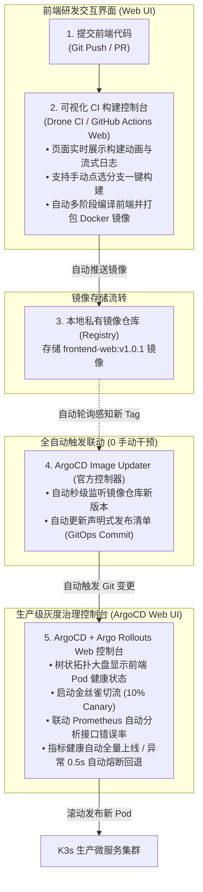

# 最佳工程闭环：可视化前端构建 (Visual CI) + ArgoCD/Rollouts 灰度治理

> **文档版本**：v1.0.0  
> **制定日期**：2026-11-19  
> **设计目标**：**“既要代码提交后在 Web 界面上可视化操作打包，又要享受 ArgoCD + Argo Rollouts 强大的企业级灰度与自动熔断治理，全流程彻底杜绝手动打镜像”**。

---

## 一、 为什么“构建”与“发布”必须解耦？（业界大厂标准模式）

在生产级软件工程中，**“镜像构建 (CI)”** 和 **“集群发布治理 (CD)”** 是分工明确的两个独立阶段：

1. **可视化构建阶段 (Visual CI)**：
   - 专职负责：拉取源码、执行依赖安装（`pnpm install`）、语法检查、打包压缩、制作极简 Docker 镜像并推送至私有镜像仓库。
   - 交互体验：**完全通过 Web 界面可视化操作**，点击按钮触发或 Git 提交自动触发，页面实时流式展示构建日志。
2. **灰度发布与治理阶段 (GitOps CD - ArgoCD + Rollouts)**：
   - 专职负责：感知新镜像版本、渐进式金丝雀流量分流（10% $\rightarrow$ 50% $\rightarrow$ 100%）、Prometheus 指标健康度分析判定、秒级一键回滚。
   - 核心价值：**全自动化联动，开发人员无需在本地敲任何命令行，即可在 Web 界面上完成从构建到生产灰度全流程**。

---

## 二、 全自动闭环工作流架构图



---

## 三、 现成轻量、带 Web UI 的构建引擎推荐

为了与本地已确定的 **K3s 集群** 完美啮合，同时保证单机资源开销极低（仅需 100MB~200MB），推荐以下两套开箱即用的可视化 CI 引擎：

### 方案 1：Drone CI / Woodpecker CI —— 最轻量、最现代化的可视化构建平台【首选推荐】
- **定位**：轻量级云原生 CI 引擎，单个 Docker 容器直接拉起，内存仅需 **~100MB**。
- **Web UI 体验**：
  - 支持 GitHub / GitLab / Gitea 账号一键授权登录；
  - 开发者在 Web 界面上可以：
    1. 点击 **“New Build”** 按钮手动选择分支触发构建；
    2. 实时查看多阶段流水线动画（`Install Dependencies` $\rightarrow$ `Build Frontend` $\rightarrow$ `Docker Push`）；
    3. 流式查看高亮终端日志。
- **流水线声明配置 (`.drone.yml`)**：
  前端项目根目录下仅需放一个简单的声明文件，构建逻辑全自动：
  ```yaml
  kind: pipeline
  type: docker
  name: frontend-build

  steps:
    - name: build-and-push-image
      image: plugins/docker
      settings:
        repo: localhost:5000/frontend-web
        tags:
          - latest
          - v1.0.${DRONE_BUILD_NUMBER}
        registry: localhost:5000
  ```

---

### 方案 2：GitHub Actions / Gitea Actions —— 原生集成在代码仓中的现代化 Web UI
- 如果项目托管在 GitHub，直接使用现成的 **GitHub Actions**：
  - 拥有业界最强大的图形化工作流界面；
  - 支持配置 `workflow_dispatch`，在 GitHub 页面点击 **“Run workflow”** 按钮手动传参构建。
- 如果是本地私有 Git，本地运行一个轻量级 **Gitea**（Go 语言编写，内存仅需 80MB），自带与 GitHub Actions 100% 兼容的 Web UI。

---

## 四、 核心桥梁：`argocd-image-updater` 如何实现 0 手动自动对接？

开发者最担心的就是：“CI 打包完镜像后，我还要手动去修改 K8s 配置文件吗？”  
**答案是：完全不用！**

ArgoCD 官方提供了一个神器插件：**`argocd-image-updater`**。
在前端应用的 K8s 清单中仅需加两行注解：

```yaml
apiVersion: argoproj.io/v1alpha1
kind: Application
metadata:
  name: frontend-app
  annotations:
    # 告诉 ArgoCD 自动监听这个镜像仓库的前端镜像
    argocd-image-updater.argoproj.io/image-list: web=localhost:5000/frontend-web
    # 策略：一旦发现有新版本 SemVer Tag (如 v1.0.2)，自动触发升级
    argocd-image-updater.argoproj.io/web.update-strategy: semver
spec:
  # ...
```

### 自动化链路全景运作流程：
1. 前端在 Web CI 上点击“构建”，镜像打出 `frontend-web:v1.0.2` 并推到 Registry；
2. `argocd-image-updater` 在 10 秒内自动检测到新 Tag，自动向 Git 仓库提交一个变更 Commit；
3. ArgoCD 监听到变更，立刻驱动 **Argo Rollouts** 启动金丝雀灰度发布；
4. 开发者刷新 ArgoCD 网页，就能看到流量正在平滑地从 `v1.0.1` 灰度切换到 `v1.0.2`！

---

## 五、 最终体验总结

| 操作环节 | 开发者实际体验 | 是否需要手动写脚本/敲命令？ |
|---|---|---|
| **代码提测** | 正常 `git push` 提交业务代码。 | ❌ 不需要 |
| **触发构建** | 在 CI 网页上看到构建流水线绿灯自动亮起，或手动点击 **“Trigger Build”**。 | ❌ 纯 Web 界面点选 |
| **镜像打包** | 平台在后台多阶段自动生成 20MB 极简 Nginx 镜像并打标入库。 | ❌ 平台全自动 |
| **灰度发布** | 自动触发 ArgoCD，打开 **Argo Rollouts Dashboard** 网页查看金丝雀灰度分流。 | ❌ 自动触发，网页观测 |
| **指标监控与回滚** | Prometheus 自动监控质量，若有白屏异常自动秒级回滚，或在网页上一键回滚。 | ❌ 自动化熔断，大盘点选 |

**结论**：通过 **“轻量 Web CI (Drone/Actions) + 本地 Registry + ArgoCD Image Updater + Argo Rollouts”**，不仅完全解决了“手动打包”的顾虑，而且实现了业内最顶级的**全可视化操作与生产级灰度自愈闭环**！
